# Epic: Tủ thuốc cá nhân

Size: L · chạm dữ liệu sức khỏe của nhiều người (Owner, mẹ, có thể thêm người khác); ghi sai liều có thể gây hại khi dùng lại

## Status: broken-down

Breakdown ngày 2026-10-28: một slice, các bước nằm ở mục Tasks, không có file task. Slice 2 (nhập bằng AI) chưa có AC; slice 2 cần chạy phase 2 riêng trước khi breakdown.

Phase 1 (Problem Discovery) đã xong ngày 2026-10-23: Owner (cũng là người đưa vấn đề) đã trả lời vòng confirm. Phase 2 (Solution Design) xong ngày 2026-10-23: Owner (ở vai Manager) duyệt phần design (nay là E4). Ngày 2026-10-24 checklist đổi thứ tự: phase 3 giờ là Flow & Prototype, phase 4 là Acceptance & Test Design. Ngày 2026-10-24 Claude soạn phase 3 (Flows and screens: 7 flow, 9 màn hình, pattern chung, bảng lỗi API, data dictionary, ma trận phân quyền) và map quy tắc E6 vào flow và màn hình; Owner đã chốt flow, màn hình, data dictionary và ma trận phân quyền; bỏ qua mockup (3.6) [Owner]. Ngày 2026-10-27 áp dụng 17 phát hiện của review flow (3.1) và thêm số phase vào tiêu đề; cùng ngày đổi số section để mỗi section thuộc đúng một phase (E0 cho câu hỏi, 'E4 Design', 'E5 Flows and screens') và bỏ mã quy tắc khỏi E5. Owner chốt câu chữ theo trạng thái (3.7) ngày 2026-10-27. Phase 4 ('E6 Rules and examples') chốt ngày 2026-10-28. Checklist size L, run 1 (xem `learning/workflow/run-log.md`). Các bản phát hành gọi là **slice 1, slice 2** để không lẫn với phase của checklist.

**Đọc theo phase** (checklist size L, `learning/workflow/checklist-size-l.md`):

| Phase của checklist | Section trong epic | Trạng thái |
|---|---|---|
| 1 · Problem Discovery | E1, E2, E3 | xong |
| 2 · Solution Design | E4 | xong |
| 3 · Flow & Prototype | E5 | xong |
| 4 · Acceptance & Test Design | E6 | xong |
| 5, 6, 7 · Implementation, Testing, Release | mục Tasks (không đánh số; thêm khi breakdown, thay cho file task vì epic chỉ có 1–2 slice) | đã breakdown; chưa code. Mỗi slice: cách làm (5.1a), test viết trước code (5.1b), rồi code (5.1c) |
| 8 · Post-release Review | E7 (thêm sau khi phát hành) | chưa |

Mỗi section có số thuộc đúng một phase. Section không có số dùng chung: E0 · Questions dùng ở mọi phase (câu hỏi mới nằm ở cuối bảng, cột Date cho biết hỏi ở phase nào); Status và Changelog ghi tiến độ. Section của phase trước không dẫn mã của phase sau: flow và màn hình (E5) không ghi mã quy tắc; quy tắc (E6) ghi ngược lại flow và màn hình mà nó phủ, ở dòng in nghiêng dưới tiêu đề.

Trạng thái duyệt của một section nằm ở dòng "Trạng thái:" ngay dưới tiêu đề, ở mọi cấp tiêu đề. `[Owner]` nghĩa là Owner đã chốt; `[Claude-proposed]` nghĩa là Claude soạn và Owner chưa chốt. Nếu Owner chỉ cần duyệt một phần của section, dòng trạng thái ghi rõ phần đó. Nhãn trong ngoặc vuông ở cuối một câu hay ở cột Source là **nguồn** của nội dung (ví dụ `[Q-2]`, `[Owner]`), không phải trạng thái duyệt.

## Legend

Tiền tố ID theo `ids-and-references.md` của ctx plugin, dùng chung cho mọi epic. Trong câu văn, ID luôn đi kèm tên ngắn, đặt trong dấu nháy đơn (ví dụ 'S6 Trang tra cứu'); dấu nháy kép dành cho câu chữ hiện trên giao diện; ID trơn chỉ nằm ở cột Source, Covers, Rule và trong `[...]`. Trong Obsidian, hover lên link để xem, `Cmd+Alt+←` để quay lại.

| Tiền tố | Là gì | Định nghĩa ở |
|---|---|---|
| `E0`–`E7` | Section của epic (**E**pic section) | tiêu đề `##` |
| `Q-n` | Câu hỏi cho Owner (**Q**uestion) | [[#E0 · Questions · mọi phase]] |
| `Fn`, `Fna` | Flow (**F**low); chữ cái là nhánh | [[#Flows]] |
| `Sn` | Màn hình hoặc hộp thoại (**S**creen) | [[#Danh sách màn hình]] |
| `Rn` | Quy tắc (**R**ule) | [[#Rules]] |
| `Rn.m` | Example của quy tắc `Rn` | bảng dưới mỗi quy tắc |
| `Pn` | Pattern kế thừa (**P**attern): hành vi có sẵn, chỉ trích dẫn | [[#Hành vi kế thừa]] |
| `AC-n` | Acceptance criterion | [[#Acceptance criteria and test levels]] |
| `DT-n` | Decision table | [[#Test design]] |
| `ST-n` | State transition table | [[#Test design]] |
| `SR-n` | Convention của project | `.context/style-review.md` |
| bảng tra `J4`, `B` | Mục của bảng tra checklist | `learning/workflow/bang-tra.md` |

## E0 · Questions · mọi phase

| # | Question | Who answers | Answer | Date | Blocking |
|---|---|---|---|---|---|
| Q-1 | Giả định: app chỉ ghi lại và tra lại, không bao giờ gợi ý thuốc. Đúng không? | Owner | Đúng | 2026-10-23 | yes |
| Q-2 | Ở nhà thuốc, bạn cần đưa ra cái gì: tên biệt dược, tên hoạt chất, hay hình hộp thuốc? | Owner | Tên hoạt chất nếu chỉ có một hoạt chất; tên thuốc chính xác nếu có nhiều hoạt chất | 2026-10-23 | yes |
| Q-3 | Bạn có muốn ghi cả thuốc "đã thử, chưa biết kết quả" và thuốc "không hợp"? | Owner | Cần, vì đây là ghi nhận thuốc đã sử dụng | 2026-10-23 | no |
| Q-4 | Một ghi chép cũ thì bạn cần biết nó cũ cỡ nào (ngày dùng gần nhất), hay cần app nhắc xem lại? | Owner | Tạm thời chưa quan tâm | 2026-10-23 | no |
| Q-5 | Có thuốc nào bạn hoặc mẹ dùng lâu dài không, hay toàn dùng theo đợt? | Owner | Có dùng lâu dài: thuốc mỡ máu | 2026-10-23 | no |
| Q-6 | Một lần research lại hôm nay tốn bao lâu, ước chừng? | Owner | 10–20 phút nếu là thuốc mới, 2–3 phút nếu là thuốc đã dùng | 2026-10-23 | no |
| Q-7 | Bỏ ô "ngày dùng gần nhất", chỉ giữ ngày ghi và ngày sửa do hệ thống tự ghi. Đúng không? | Owner | Đồng ý | 2026-10-23 | no |
| Q-8 | Để kịp 1–2 buổi: người (`HealthProfile`) chỉ cần thêm và đổi tên trong một danh sách nhỏ ở console, không cần trang chi tiết. Đúng không? | Owner | Đồng ý | 2026-10-23 | yes |
| Q-9 | Xóa một sản phẩm: xóa hẳn, hay vào thùng rác khôi phục được (soft delete, dữ liệu còn mãi)? Xóa một người khi còn sản phẩm: chặn lại, hay xóa luôn các sản phẩm? | Owner | Database luôn soft delete theo khuôn chung; UI xóa hẳn, có xác nhận. Phần xóa người còn sản phẩm chưa trả lời (→ Q-11) | 2026-10-23 | yes |
| Q-10 | Lịch sử sửa sau này lưu nguyên văn những field nào (ví dụ liều, kết quả), hay chỉ lưu tên field đã đổi? Có thể để tới lúc làm audit trail | Owner | Lưu nguyên văn, chuẩn banking: field nào sửa, ai sửa, lúc nào, lọc theo action. Làm ở slice sau | 2026-10-23 | no |
| Q-11 | Xóa một người khi người đó còn sản phẩm: chặn lại và báo còn bao nhiêu sản phẩm, hay xóa luôn các sản phẩm của họ? (mặc định: chặn lại) | Owner | Báo số sản phẩm để Owner xác nhận; xác nhận thì xóa luôn các sản phẩm | 2026-10-23 | yes |
| Q-12 | Field bắt buộc chỉ là người, loại, tên; còn lại để trống được, để nhập nhanh. Đúng không? | Owner | Bắt buộc: người (profile), tên, hàm lượng (ô riêng, không ghi chung với tên), loại (mặc định là Thuốc). Hàm lượng chỉ bắt buộc với thuốc, vì vật tư không có ô này [R2] | 2026-10-24 | yes |
| Q-13 | Đổi một thuốc sang vật tư khi nó đã có liều, hoạt chất: xóa các field đó khi lưu (có cảnh báo), hay không cho đổi loại sau khi tạo? (mặc định: không cho đổi loại) | Owner | Không cho đổi loại sau khi tạo; cần đổi thì xóa sản phẩm đó và tạo sản phẩm mới | 2026-10-24 | yes |
| Q-14 | Danh sách tra cứu mặc định mở ở chế độ nào (mini card hay dòng), và có nhớ lựa chọn lần trước không? | Owner | Mặc định dòng (row/table); nhớ lựa chọn | 2026-10-24 | no |
| Q-15 | Nhớ chế độ xem theo từng thiết bị (localStorage: điện thoại và desktop nhớ riêng), hay theo tài khoản (lưu trên server, mọi thiết bị giống nhau)? (mặc định: theo thiết bị) | Owner | Theo thiết bị | 2026-10-24 | no |
| Q-16 | Khi chưa gõ gì, trang tra cứu xếp sản phẩm theo thứ tự nào: tên hiển thị A→Z, hay sản phẩm sửa gần nhất lên đầu? (mặc định: A→Z) | Owner | A→Z theo tên hiển thị | 2026-10-24 | no |
| Q-17 | Cùng một người có hai sản phẩm trùng tên (Paracetamol 500mg và Paracetamol 250mg): cho lưu, cho lưu kèm cảnh báo, hay chặn? (mặc định: cho lưu, không cảnh báo) | Owner | Theo mặc định: cho lưu, không cảnh báo | 2026-10-24 | no |
| Q-18 | Chế độ dòng trên điện thoại hiện những cột nào, và ghi chú (nơi ghi "không hợp") hiện ra sao: luôn hiện, cắt một dòng, hay bấm vào dòng mới mở ra? | Owner | Ghi chú: bấm vào dòng mới mở ra (thay bởi Q-41: bấm icon ghi chú). Các cột trên điện thoại: chốt ở mockup (3.6) | 2026-10-24 | no |
| Q-19 | Hết phiên đăng nhập khi đang điền form ở console: chấp nhận mất dữ liệu đang điền, hay phải giữ lại? (mặc định: theo cách console đang xử lý cho mọi form, không làm riêng) | Owner | Theo mặc định: theo cách console đang xử lý (xem bảng lỗi API) | 2026-10-24 | no |
| Q-20 | Icon sửa trên trang tra cứu mở console, mà console chưa responsive và có thể đòi đăng nhập lại. Trên điện thoại: giữ icon (chấp nhận màn hình khó dùng), hay ẩn icon dưới laptop? (mặc định: giữ, đúng ý Owner "responsive console tính sau") | Owner | Giữ icon | 2026-10-24 | no |
| Q-21 | `HealthProfile` bỏ field "quan hệ với Owner", vì tên người đã đủ ("Mẹ"); và tên người không được trùng (không phân biệt hoa thường). Đúng không? | Owner | Đúng | 2026-10-24 | no |
| Q-22 | Thời điểm uống là danh sách chọn (Trước ăn, Sau ăn, Trong bữa ăn, Lúc nào cũng được) hay chữ tự do? (mặc định: danh sách chọn, chi tiết khác ghi vào ghi chú) | Owner | Danh sách chọn (`enum`) | 2026-10-24 | no |
| Q-23 | Console có cần trang chi tiết cho một sản phẩm không, hay chỉ danh sách và form, vì đọc đã có trang tra cứu? (mặc định: chỉ danh sách và form) | Owner | Không cần trang chi tiết | 2026-10-24 | no |
| Q-24 | Bật và tắt nhãn "Cần mua" ở đâu: chỉ ở form console (trang tra cứu giữ chỉ đọc), hay thêm một nút bật tắt nhanh ngay trên trang tra cứu (dùng được trên điện thoại khi kiểm tủ)? (mặc định: chỉ ở console) | Owner | Không cần: đã bỏ nhãn "Cần mua" | 2026-10-24 | no |
| Q-25 | Lỗi 500 khi lưu form ở console: console hiện đóng mọi hộp thoại và mở trang lỗi 500, nên dữ liệu đang điền có thể mất (bản nháp R13.1 cũ ghi "form giữ nguyên dữ liệu"). Theo console như Q-19, hay làm riêng cho form này? (mặc định: theo console) | Owner | Theo console. Kiểm tra code: việc chuyển sang trang lỗi đi qua `unsavedChangesGuard`, nên Owner được hỏi trước và chọn ở lại thì dữ liệu còn | 2026-10-27 | no |
| Q-26 | 'S6 Trang tra cứu' đang tải thì có phải giữ đúng layout của chế độ xem đã nhớ (dòng hoặc mini card) không? (mặc định: không yêu cầu, dùng chỉ báo đang tải có sẵn của landing) | Owner | Không cần giữ layout | 2026-10-27 | no |
| Q-27 | Ở form tạo, đổi Thuốc → Vật tư → Thuốc thì giữ hay xóa liều, hoạt chất đã gõ? (mặc định: giữ trên màn hình; lưu khi đang là Vật tư thì không gửi các field thuốc) | Owner | Tự xóa: đổi loại thì các field chỉ dành cho loại cũ bị xóa ngay, không cảnh báo. Là pattern chung cho mọi form (chờ đưa vào tài liệu chuẩn) | 2026-10-27 | no |
| Q-28 | Thêm lại một người trùng tên với người đã xóa thì có cho phép không? (mặc định: cho phép; kiểm tra trùng tên chỉ xét người chưa xóa) | Owner | Cho phép. Là pattern chung: kiểm tra trùng chỉ xét bản ghi chưa xóa (chờ đưa vào tài liệu chuẩn) | 2026-10-27 | yes |
| Q-29 | Có trim khoảng trắng hai đầu trước mọi kiểm tra không? (mặc định: có; chuỗi chỉ có khoảng trắng tính là rỗng; hoạt chất rỗng sau khi trim bị bỏ, không báo lỗi) | Owner | Có, làm ở Zod (DTO). Là pattern chung (chờ đưa vào tài liệu chuẩn) | 2026-10-27 | yes |
| Q-30 | Ở 'S6 Trang tra cứu' có chọn nhiều chip người cùng lúc được không? (mặc định: chỉ một; bấm chip mới thì thay chip cũ) | Owner | Chọn một hoặc bỏ chọn: chip mới thay chip cũ; bấm lại chip đang chọn thì bỏ chọn | 2026-10-27 | no |
| Q-31 | Chip của người chưa có sản phẩm nào có hiện ở 'S6 Trang tra cứu' không? (mặc định: ẩn) | Owner | Ẩn | 2026-10-27 | no |
| Q-32 | Bật chip "Mang đi" và chip "Mẹ", Mẹ không có sản phẩm mang đi nhưng Owner có: hiện gì? (mặc định: "Không tìm thấy sản phẩm nào" kèm "Xóa bộ lọc"; "Chưa có sản phẩm mang đi" chỉ hiện khi không ai có nhãn) | Owner | Theo mặc định | 2026-10-27 | no |
| Q-33 | Chế độ mini card: ghi chú và field trống hiện thế nào? (mặc định: như chế độ dòng; ghi chú ẩn, bấm card mới mở; "Chưa ghi" cho field áp dụng; vật tư không hiện field thuốc) | Owner | Theo mặc định | 2026-10-27 | no |
| Q-34 | Từ 'S6 Trang tra cứu' bấm sửa một sản phẩm đã bị xóa, nút "Back to list" về đâu? (mặc định: về S6 khi `returnTo` hợp lệ, còn lại về 'S1 Danh sách sản phẩm') | Owner | Theo mặc định | 2026-10-27 | no |
| Q-35 | 'S6 Trang tra cứu' có dòng phụ dưới tên chính không, định dạng ra sao, và vật tư có nhãn "Vật tư" không? (mặc định: dòng phụ là tên thuốc khi tên chính là hoạt chất, hoặc các hoạt chất nối bằng " + " khi tên chính là tên thuốc; vật tư có nhãn "Vật tư") | Owner | Có dòng phụ và có nhãn "Vật tư". Dòng phụ của vật tư → Q-38 | 2026-10-27 | no |
| Q-36 | Ngưỡng hiệu năng của 'S6 Trang tra cứu' là bao nhiêu? (mặc định: hiện danh sách dưới 1 giây với 300 sản phẩm; mỗi phím gõ lọc xong dưới 100 ms) | Owner | Theo ngưỡng chung của API system, làm ở một epic riêng; epic này không đặt ngưỡng riêng | 2026-10-27 | no |
| Q-37 | Sắp xếp A→Z có theo thứ tự tiếng Việt không ("Đ" đứng sau "D", dùng `localeCompare('vi')`)? (mặc định: có) | Owner | Theo mặc định | 2026-10-27 | no |
| Q-38 | Vật tư có dòng phụ dưới tên chính không, và nếu có thì là gì? (mặc định: không có dòng phụ, chỉ có nhãn "Vật tư"; dòng phụ của thuốc dùng để nối tên thuốc với hoạt chất, vật tư không có hoạt chất) | Owner | Theo mặc định | 2026-10-27 | no |
| Q-39 | Ở 'S6 Trang tra cứu', các nhóm người xếp theo thứ tự nào? (mặc định: tên người A→Z theo tiếng Việt, như Q-37; đầu mỗi nhóm có tên người và số sản phẩm; nhóm không còn sản phẩm khớp bộ lọc thì ẩn) | Owner | Theo mặc định | 2026-10-27 | no |
| Q-40 | Ở chế độ dòng, vật tư hiện thế nào khi chỉ có các field chung? (mặc định: trong mỗi nhóm người, tách thành hai bảng con "Thuốc" rồi "Vật tư", mỗi bảng có bộ cột riêng; bảng con rỗng thì ẩn) | Owner | Theo mặc định | 2026-10-27 | no |
| Q-41 | Ghi chú hiện thế nào ở 'S6 Trang tra cứu'? (mặc định: icon ghi chú chỉ hiện khi có ghi chú; bấm hoặc chạm icon, hoặc nhấn Enter khi icon đang focus, thì ghi chú mở ra ngay dưới dòng hoặc trong card; bấm lần nữa thì đóng. Phương án khác: tooltip khi hover; popover khi bấm) | Owner | Theo mặc định (thay cách xem ghi chú của Q-18) | 2026-10-27 | no |
| Q-42 | Từ khóa và chip lọc có nằm trên URL không? (mặc định: có, `?q=`, `?person=`, `?travel=1`; cập nhật bằng `replaceUrl` để không tạo một mục lịch sử cho mỗi phím gõ; nếu bật lại Umami thì cấu hình để Umami không ghi phần query) | Owner | Theo mặc định; ghi thành SR-008 | 2026-10-27 | yes |
| Q-43 | Trên điện thoại (dưới tablet), các màn hình console của module này hiện thế nào? (mặc định, theo trang Radar có sẵn: 'S1 Danh sách sản phẩm' và 'S4 Trang người' đổi bảng thành danh sách card một cột; các nút ở header gom vào một menu; 'S2 Form sản phẩm' một cột; 'S3 Hộp xóa sản phẩm', 'S5 Hộp xóa người', 'S10 Hộp tên người' rộng hết màn hình; sidebar giữ hành vi sẵn có của shell) | Owner | Theo mặc định | 2026-10-27 | no |
| Q-44 | 'S1 Danh sách sản phẩm' có những cột nào, và cột tên dùng tên hiển thị (R1) hay tên in trên hộp? (mặc định: tên hiển thị kèm dòng phụ như S6, rồi cột Person, Type, Travel, Updated, và nút Delete ở cuối dòng; bấm dòng thì mở 'S2 Form sản phẩm') | Owner | Theo mặc định | 2026-10-28 | yes |
| Q-45 | 'S1 Danh sách sản phẩm' có phân trang và ô tìm không? (mặc định: phân trang như trang Tags; không có ô tìm, vì tìm đã có ở 'S6 Trang tra cứu'; lọc theo người nằm trên URL `?person=` theo SR-008) | Owner | Theo mặc định | 2026-10-28 | no |
| Q-46 | 'S4 Trang người' và ô Person của 'S2 Form sản phẩm' xếp người theo thứ tự nào? (mặc định: tên A→Z theo tiếng Việt, như Q-39) | Owner | Theo mặc định | 2026-10-28 | no |
| Q-47 | Ở 'S4 Trang người', đổi tên hoặc xóa một người đã bị xóa ở tab khác thì sao? API trả 404, và console không có xử lý chung cho 404. (mặc định: xóa thì coi như xong, giống R13.9: toast "Person deleted", tải lại S4; đổi tên thì 'S10 Hộp tên người' đóng, toast "This person no longer exists", tải lại S4) | Owner | Theo mặc định | 2026-10-28 | no |
| Q-48 | Sửa một vật tư đã lưu (PATCH) mà gửi kèm field chỉ thuốc mới có, ví dụ `dose`, thì sao? Chưa example nào phủ. (mặc định: API trả 400 `MEDICAL_ITEM_INVALID_INPUT` với lỗi tại `dose`, giống R2.2 lúc tạo; dữ liệu không đổi) | Owner | API trả 400 và không lưu. Đây là kiểm tra của API: UI không gặp trường hợp này, vì form vật tư đã ẩn ô liều dùng [Owner] | 2026-10-29 | no |

## E1 · Problem *(logic)* · Phase 1

**Problem:** Khi đi xa, đang vội, hoặc ở nhà mà cần thuốc hay y tế phẩm, Owner không nhớ trước đây mình (hoặc mẹ) đã dùng gì, nên không dùng lại được và không chuẩn bị được cho chuyến đi. [Owner]

**Lõi của vấn đề:** lưu trữ tri thức và kinh nghiệm của Owner và người thân về thuốc, y tế phẩm, để tra cứu lại một cách đơn giản. Hai hành động chính: **lưu trữ** và **tra cứu**. Mục tiêu lớn của việc tra cứu là **chuẩn bị**: khi sắp đi xa, vài cú bấm là có danh sách sản phẩm cần mang. Owner xem danh sách và tự đối chiếu với đồ đang có; app không theo dõi tồn kho hay sản phẩm cần mua. Tủ thuốc gia đình coi như chứa mọi sản phẩm có thể dùng; sản phẩm nào mang đi thì gắn nhãn. [Owner]

**Evidence:** ví dụ thật: tra lại "Simethicone"; chuẩn bị thuốc dạ dày cho chuyến Hà Nội 3 ngày. Không có sự cố cụ thể nào; hậu quả là mất thời gian research lại nhiều lần. [Owner]

**Why now:** không có deadline; feature này là ticket thật đầu tiên để chạy thử checklist size L. [Owner]

**Users and context:** chỉ Owner dùng app. Người **được ghi dữ liệu** là một chuyện khác: Owner, mẹ, và có thể thêm người khác sau này; mẹ không dùng app. Owner dùng cả landing lẫn console, cả điện thoại lẫn desktop. Tình huống cần tra xảy ra không cố định (đi khám, đi xa, có vấn đề sức khỏe), cách nhau vài ngày đến vài tháng. [Owner]

**How they do it today:** hỏi thẳng AI (Claude), không lưu lại gì, rồi quên. Các cách khác Owner không tin bằng: dược sĩ ở nhà thuốc (họ là người bán hàng), bác sĩ (tốn thời gian), web/AI (không chắc chắn, không biết lịch sử của Owner). Owner tin nhất là thuốc mình đã từng dùng. [Owner]

## E2 · Done and measure *(logic)* · Phase 1

| Measure | Baseline (today) | Target | How it is read |
|---|---|---|---|
| Thời gian từ lúc cần tới lúc biết thuốc nào + liều bao nhiêu | hỏi lại AI: 10–20 phút với thuốc mới, 2–3 phút với thuốc đã dùng (Owner ước, 2026-10-23) [Q-6] | dưới 1 phút trên điện thoại [Owner] | Owner tự bấm giờ ở 2–3 lần tra đầu tiên |

Khi xong: Owner mở landing, lọc ra danh sách sản phẩm mang đi chỉ với vài cú bấm; hoặc tra ra thuốc đã dùng, đối chiếu với thuốc thật đang cầm trên tay, nhanh hơn và đáng tin hơn hỏi AI. [Owner]

## E3 · Scope *(logic)* · Phase 1

### In
| Capability | Covered by |
|---|---|
| Lưu một thuốc hoặc y tế phẩm đã dùng, cho Owner hoặc cho mẹ [Owner] | F1a, S2, R2, R3 |
| Mỗi người có một profile thuốc riêng, hoặc cách nào đó nhìn vào là biết rõ thuốc nào của ai; số người không giới hạn ở hai [Owner] | F1b, F4a, F4b, S4, S10, R5, R7, R11 |
| Ghi cả thuốc đã dùng mà không hợp hoặc chưa rõ kết quả, vì đây là ghi nhận "thuốc đã sử dụng" [Q-3] | F1a, S2, S6, R3.6, R3.8, R6.5 |
| Thuốc dùng lâu dài (ví dụ thuốc mỡ máu) lẫn thuốc dùng theo đợt [Q-5] | F1a, F5, S2, S6, R6.2, R6.3 |
| Tên để tra và đưa ở nhà thuốc: tên hoạt chất nếu thuốc chỉ có một hoạt chất; tên thuốc chính xác nếu thuốc có nhiều hoạt chất, kể cả khi công thức phối hợp là loại phổ biến [Q-2] | F5, S6, R1 |
| Tra lại theo tên thuốc [Owner] | F5, S6, R4 |
| Một view thấy mọi sản phẩm của tất cả mọi người, lọc được theo người [Owner] | F5, S6, R5 |
| Ghi cả vật tư y tế (nhiệt kế, băng gạc), không chỉ thuốc [Owner] | F1a, S2, R2, R1.4 |
| Tra theo mục đích hoặc triệu chứng, khi Owner không biết tên thuốc cần tìm ("bệnh A thì dùng gì") [Owner] | F5, S6, R4.1 |
| Slice 1 nhập tay. Thông tin tối thiểu: tên thuốc, mục đích, liều/hàm lượng, thời điểm và cách uống (trước hay sau ăn) [Owner] | F1a, S2, R3, R6, data dictionary |
| Một danh sách, không có bản nháp [Owner] | F1a, R3.1 |
| Màn hình console của module này dùng được trên điện thoại (chỉ module này, phần còn lại của console để sau) [Owner] | S1–S5, S10, P13 |
| Gắn nhãn "Mang đi" cho sản phẩm cần mang khi đi xa; lọc ra danh sách mang đi, kết hợp được với lọc theo người. Mọi sản phẩm mặc định là đồ trong tủ ở nhà [Owner] | F7, S2, S6, R14 |

### Out
- Người dùng app khác (bạn bè, nhiều tài khoản, thương mại hóa). Khác với người được ghi dữ liệu ở mục In [Owner]
- Gợi ý thuốc hay chẩn đoán: đây là trí nhớ cá nhân, không thay bác sĩ [Q-1]
- Nhắc xem lại ghi chép cũ: tạm thời chưa quan tâm [Q-4]
- Lịch sử sửa: chưa cần trong slice này, nhưng sẽ đến từ một chuẩn chung cho mọi feature (→ History ở 'E4 Design') [Owner]
- Nhập tự động (AI qua MCP, hoặc OCR): để slice 2 [Owner]
- Tồn kho và danh sách cần mua (số lượng, còn hay hết, nhãn "Cần mua"): không làm; Owner xem danh sách và tự đối chiếu [Owner]
- Đánh dấu hoặc tick từng sản phẩm (ví dụ tick sản phẩm đã gom vào túi): không làm [Owner]
- Trang chi tiết một sản phẩm ở console: không làm; đọc đã có trang tra cứu [Q-23]
- Giá: không cần [Owner]
- Tính số lượng mang theo số ngày đi: không làm, nhãn "Mang đi" là đủ [Owner]

### Situational edge cases

Phép thử tờ giấy: nếu Owner ghi bằng một cuốn sổ giấy thì edge case này vẫn xảy ra không? Có → edge case của tình huống, ghi ở đây. Không → edge case do phương án sinh ra, để phase 2.

| Edge case | Decision | Note |
|---|---|---|
| Owner không biết cần tra gì, chỉ biết triệu chứng | in | tra theo mục đích [Owner] |
| Thông tin cũ không được cập nhật, thành kiến thức cũ hoặc sai | out (slice 1) | chưa quan tâm [Q-4] |
| Nhu cầu mới hoặc thuốc mới, chưa có kinh nghiệm | in | ghi là đã dùng, chưa rõ kết quả [Q-3] |
| Ở nhà thuốc nơi khác, cùng hoạt chất nhưng tên biệt dược khác (Simethicone bán dưới nhiều tên) | in | tra theo hoạt chất khi chỉ có một hoạt chất [Q-2] |
| Cùng một thuốc, liều của Owner khác liều của mẹ; lấy nhầm liều của người kia | in | mỗi người một profile thuốc [Owner] |
| Thuốc từng dùng nhưng không hợp hoặc bị dị ứng | in | [Q-3] |
| Thuốc dùng theo đợt (vài ngày) khác thuốc dùng lâu dài | in | có thuốc dùng lâu dài: thuốc mỡ máu [Q-5] |
| Mạng yếu hoặc mất mạng | out | mặc định mạng nhanh, không làm offline [Owner] |
| Ghi chép sai liều, Owner tin ghi chép hơn dược sĩ nên dùng sai | in | ghi chép phải dễ sửa ('F6 Sửa từ tra cứu', R16.3); không ghi nguồn, mặc định tin dữ liệu Owner nhập [Owner] |

**Affected indirectly:** mẹ và những người khác được ghi dữ liệu (dữ liệu sức khỏe của họ nằm trong hệ thống dù họ không dùng app). [Owner]

## E4 · Design · Phase 2

**Chosen option:** console để quản lý (CRUD), một trang private trên landing để tra cứu [Owner]
**Why (Owner's words):** "console CRUD, landing tra cứu" [Owner]

### Options considered
| Option | Pros | Cons | Why not |
|---|---|---|---|
| A. Một trang private trên landing, vừa nhập vừa tra | một giao diện, nhập được trên điện thoại | form phải tự làm bằng `landing-*` | Owner muốn quản lý ở console |
| **B. Console CRUD + landing tra cứu** | console có sẵn khuôn CRUD (feature-tag); landing chỉ đọc nên nhẹ | hai giao diện | được chọn |
| C. File markdown trong repo learning, push lên như checklist | gần như không cần backend; git giữ lịch sử | không nhập được từ điện thoại; mỗi lần sửa phải push | không khớp cách Owner muốn quản lý |

### Data model

Trạng thái: [Owner]

- **`HealthProfile`**: một người được ghi dữ liệu (chỉ có tên; tên không trùng, không phân biệt hoa thường [Q-21]). Không phải tài khoản đăng nhập.
- **`MedicalItem`**: một sản phẩm trong tủ, thuộc về một `HealthProfile`.
  - Chung: `kind` (`MEDICINE` / `SUPPLY`), tên, mục đích hoặc triệu chứng, ghi chú, nhãn "Mang đi" (`boolean`, mặc định `false`) [Owner]
  - Không có field kết quả và field nguồn (YAGNI) [Owner]. Thuốc không hợp hoặc chưa rõ kết quả [Q-3] ghi vào ghi chú. Hệ quả đã chấp nhận: không có nhãn "Không hợp" nổi bật, và ghi chú không được tìm (R4.4); Owner tự quyết định ghi gì [Owner]
  - Chỉ `MEDICINE`: hoạt chất `activeIngredients String[]`, hàm lượng, liều, thời điểm uống (trước hay sau ăn), loại dùng (`LONG_TERM` / `COURSE`). Nghĩa, giới hạn và nhãn của từng field: data dictionary ở **Flows and screens**
  - Ngày: `createdAt`, `updatedAt` do hệ thống ghi. Không có ô "ngày dùng gần nhất" [Q-7]
- Cùng một thuốc mà hai người dùng thì là hai `MedicalItem`, vì liều có thể khác.
- **Tên hiển thị** theo Q-2: đúng một hoạt chất thì hiện tên hoạt chất, còn lại hiện tên thuốc. Luật này là một domain policy có unit test. [Owner]
- **Xóa:** database luôn soft delete (`deletedAt`), theo khuôn chung của các entity nội dung (Tag, Skill, Project, …). UI là xóa hẳn: có hộp xác nhận, không có thùng rác để khôi phục [Q-9]. Hệ quả: dữ liệu sức khỏe còn trong database sau khi xóa trên UI.
- **Xóa một người khi còn sản phẩm:** hộp xác nhận báo người đó còn bao nhiêu sản phẩm; Owner xác nhận thì xóa người và xóa luôn các sản phẩm của họ (cùng soft delete) [Q-11].

### Lookup

Trạng thái: [Owner]

- Trang private trên landing tải toàn bộ sản phẩm một lần (dữ liệu nhỏ), lọc ở trình duyệt.
- Một page: ô tìm kiếm ở trên, chip lọc theo người, kết quả có hai chế độ xem: mini card hoặc dòng (row/table), để ở nhà thuốc Owner thấy cả danh sách cùng lúc mà không phải lướt từng card [Owner]. Mặc định là dòng; trang nhớ chế độ Owner chọn lần trước [Q-14], nhớ theo từng thiết bị (localStorage) [Q-15]. Khi chưa gõ gì, sản phẩm xếp A→Z theo tên hiển thị [Q-16]. Ghi chú ẩn; dòng có ghi chú thì có icon ghi chú, bấm icon thì ghi chú mở ngay dưới dòng [Q-41]. Không dùng tab theo người (mâu thuẫn với xem tất cả) [Owner]
- Mặc định hiện mọi sản phẩm của mọi người; lọc theo người và theo nhãn "Mang đi". Các chip kết hợp với nhau và với từ khóa [Owner]
- Sản phẩm nhóm theo người: mỗi người một nhóm, mỗi nhóm có bộ dòng hoặc bộ card riêng theo chế độ xem; không trộn sản phẩm của nhiều người trong một danh sách [Owner, 2026-10-27]
- Tìm theo tên, hoạt chất, mục đích; khớp một phần (gõ "sime" ra "Simethicone") [Owner, 2026-10-27]; không phân biệt hoa thường và dấu ("thuoc da day" ra "thuốc dạ dày"). Chữ "đ" phải về "d": NFD không làm việc này, nên dùng lại cách xử lý dấu của `slug.value.ts` và có test riêng cho "đ".
- Mỗi kết quả có một icon nhỏ dẫn sang trang sửa sản phẩm đó ở console ('E3 Scope') [Owner]. Icon hiện cả trên điện thoại [Q-20]. Các màn hình console của module này (S1–S5, 'S10 Hộp tên người') responsive theo 4 breakpoint, dùng chung foundation responsive (mixins `respond-to`, `currentBp()`); phần còn lại của console vẫn để sau [Owner, 2026-10-27]
- Từ khóa và chip lọc nằm trên URL (`?q=`, `?person=`, `?travel=1`) theo SR-008 [Q-42]. Nếu bật lại Umami thì cấu hình để Umami không ghi phần query, vì từ khóa là dữ liệu sức khỏe.

### History
Không làm trong slice 1 [Owner]. Chuẩn chung dự kiến là epic audit trail (`epic-audit-trail-system.md`), nhưng epic đó **chưa có code**: chưa có module `audit`, chưa có interceptor trên `CommandBus`. Feature này chỉ chuẩn bị để được phủ sau:
- Mọi command của feature kế thừa `BaseCommand` (có `userId`), khác với command của checklist hiện nay.
- Slice 2 (machine token) cần một actor riêng cho token, vì command của radar hiện không mang actor.
- Yêu cầu cho audit trail, làm ở slice sau [Q-10]: chuẩn banking, lưu nguyên văn giá trị trước và sau; cho biết field nào đã sửa, ai sửa, lúc nào; lọc được theo action. Epic audit trail hiện mask PII, nên khi làm phải ghi một ADR cho ngoại lệ dữ liệu sức khỏe.

### Security

Trạng thái: [Owner]

- Cả controller có `@UseGuards(JwtAccessGuard, RoleGuard)` + `@Roles(['ADMIN'])` như checklist, không như tag (tag để `GET` công khai). Một e2e test: gọi `GET` không đăng nhập thì nhận 401.
- Trang landing đi trong private area: chỉ render ở trình duyệt, header `noindex`.

### Observability

Trạng thái: [Owner]

Không thêm gì trong slice 1: chỉ một người dùng, lỗi API đã có log sẵn. Không gửi sự kiện Umami nào chứa tên thuốc.

### Blast radius
- **In code:** module API mới `medicine-cabinet`; feature lib console đầu tiên dùng responsive foundation (contract hiện ghi console nằm ngoài phạm vi); Prisma migration chỉ thêm 2 bảng và enum (đảo ngược được bằng drop); console thêm một feature lib + mục menu; landing thêm một route private + mục trong `workspacePages`.
- **Outside code:** Umami, nếu bật lại, phải cấu hình không ghi phần query của URL; backup database trên Railway giờ chứa dữ liệu sức khỏe.

### Migration
Chỉ thêm bảng mới, không đụng dữ liệu cũ. Rollback: drop 2 bảng.

### Rabbit holes and appetite
- **Appetite:** 1–2 buổi cho slice 1, để kịp chạy thử checklist [Owner]
- **Rabbit holes:**
  - Offline (PWA): out, mặc định mạng nhanh [Owner]
  - Full-text search: out; lọc chuỗi con ở trình duyệt là đủ với dữ liệu nhỏ
  - Cơ sở dữ liệu thuốc bên ngoài (tự điền hoạt chất): out
  - Lịch sử sửa: chuyển sang epic audit trail
  - Form hai dạng (thuốc và vật tư): một form, ẩn các field chỉ dành cho thuốc khi `kind = SUPPLY`
  - Hai entity theo khuôn tag là khoảng 30 file; `HealthProfile` rút còn một danh sách nhỏ ở console, chỉ thêm và đổi tên, không có trang chi tiết [Q-8]

### Slices (T1)
1. **Slice 1:** API (2 entity, CRUD, list) · console CRUD theo khuôn feature-tag · trang tra cứu private trên landing
2. **Slice 2:** nhập bằng AI (machine token như radar, hoặc MCP); phase 2 của slice 2 quyết định
3. **Sau đó:** lịch sử sửa đến từ epic audit trail, không làm trong epic này

## E5 · Flows and screens · Phase 3

Trạng thái: [Owner]

Loại ticket: tính năng mới (bảng tra J1). Owner chốt từng flow, màn hình và field; chỗ nào sai thì sửa hoặc xóa. Flow vẽ bằng Mermaid; trình đọc không vẽ Mermaid thì đọc khối code như danh sách bước.

Mã J1, J4, J6 là các mục của bảng tra checklist (`learning/workflow/bang-tra.md`, mục J "Flow, màn hình và trạng thái"), không nằm trong epic này.

### Màn hình

#### Danh sách màn hình

| Screen | Tên ngắn | Là gì | App | Flows | States (bảng tra J4) |
|---|---|---|---|---|---|
| S1 | Danh sách sản phẩm | Danh sách sản phẩm | console | F0, F1a, F1b, F2, F3, F4 | lần đầu dùng (chưa có sản phẩm nào), rỗng (lọc theo một người chưa có sản phẩm), đang tải, lỗi, thành công ('S8 Toast') |
| S2 | Form sản phẩm | Form sản phẩm (tạo và sửa), không có nút Xóa | console | F1a, F1b, F2, F6 | lần đầu dùng (chưa có người), đang tải (khi sửa; danh sách người), lỗi (theo ô và lỗi API), sản phẩm đã bị xóa, người đã bị xóa, thành công ('S8 Toast', hoặc về 'S6 Trang tra cứu') |
| S3 | Hộp xóa sản phẩm | Hộp xác nhận xóa sản phẩm (`ConfirmDialog`) | console | F3 | lỗi, thành công |
| S4 | Trang người | Trang con quản lý người, link từ 'S1 Danh sách sản phẩm' như Templates của checklist: danh sách người, nút thêm; mỗi dòng có đổi tên và xóa. Thêm và đổi tên mở 'S10 Hộp tên người' | console | F4 | đang tải, lần đầu dùng, lỗi, thành công |
| S5 | Hộp xóa người | Hộp xác nhận xóa người, kèm số sản phẩm (`ConfirmDialog`) | console | F4 | người còn sản phẩm, người chưa có sản phẩm, lỗi, thành công |
| S6 | Trang tra cứu | Trang tra cứu | landing | F5, F6, F7 | có dữ liệu (nhóm theo người; trong mỗi nhóm có bảng con "Thuốc" rồi "Vật tư"), lần đầu dùng, không có kết quả, chưa có sản phẩm mang đi, đang tải, sản phẩm thiếu thông tin, lỗi, chưa đăng nhập (chuyển sang 'S7 Sign in của landing'), không có quyền (role `USER`) |
| S7 | Sign in của landing | Trang Sign in (có sẵn, không đổi) | landing | F5 | (có sẵn) |
| S8 | Toast | Toast chung (`ToastService`): "Item saved", "Item deleted", lỗi | console | F1a–F4 | thành công, lỗi |
| S9 | Đăng nhập console | Trang đăng nhập console (có sẵn, không đổi) | console | F6 | (có sẵn) |
| S10 | Hộp tên người | Hộp thêm hoặc đổi tên người (`MatDialog`), mở từ 'S2 Form sản phẩm' hoặc 'S4 Trang người' | console | F1b, F4 | thêm (ô tên trống), đổi tên (điền sẵn tên cũ), lỗi theo ô (kể cả trùng tên; hộp vẫn mở), đang gửi, thành công (đóng hộp; mở từ S2 thì người mới được chọn sẵn) |
| S11 | Trang lỗi console | Trang lỗi 403 và 500 của console (có sẵn, `feature-error`) | console | mọi flow console | (có sẵn) |

Không dùng trạng thái "mất mạng" cho màn hình nào, vì mất mạng nằm ngoài phạm vi ('E3 Scope'); khi đó màn hình hiện trạng thái lỗi.

#### Bản đồ màn hình

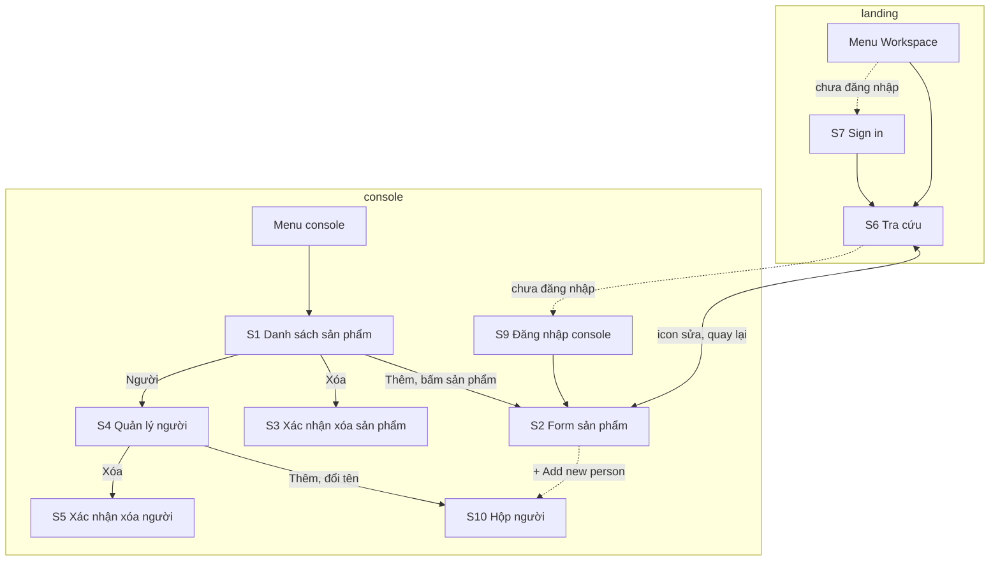

Bản đồ chỉ vẽ đường đi giữa các màn hình. Đường 'S6 Trang tra cứu' ↔ 'S2 Form sản phẩm' là 'F6 Sửa từ tra cứu': đi bằng icon sửa, quay về sau khi lưu hoặc hủy; console chưa đăng nhập thì qua 'S9 Đăng nhập console' trước. Nhánh rẽ (lỗi, chưa có dữ liệu) nằm trong từng flow. Trang lỗi 403 và 500 của console ('S11 Trang lỗi console') không vẽ ở đây, vì mọi màn hình console đều có thể dẫn tới nó (bảng lỗi API). Form sản phẩm (S2) không có nút Xóa: xóa chỉ ở 'S1 Danh sách sản phẩm' [Owner].

### Pattern chung và lỗi API

#### Pattern chung của console

Các pattern này không vẽ lại trong từng flow.

Console đã có sẵn các pattern dưới đây, dùng cho mọi feature. Flow chỉ trỏ tới chúng ("Hỏi bỏ thay đổi", "Bảng lỗi API"). Chúng vẫn có quy tắc riêng ở phase 4, vì mỗi route form phải tự gắn guard: quên gắn thì test của feature này phải bắt được.

| Hành động | Component chung (có sẵn) |
|---|---|
| Xóa sản phẩm, xóa người | `ConfirmDialog` (`console-confirm-dialog`) |
| Bấm Hủy, bấm link khác, hoặc đóng tab khi form có thay đổi chưa lưu | `unsavedChangesGuard` (`canDeactivate`) + `onBeforeUnload`, mở `UnsavedChangesDialog` (ở lại, bỏ, lưu) |
| Thông báo thành công và lỗi | `ToastService` ('S8 Toast') |
| Thêm người, đổi tên người (từ 'S2 Form sản phẩm' hoặc 'S4 Trang người') | hộp thoại Material (`MatDialog`), như các hộp khác của console ('S10 Hộp tên người') |
| Lỗi API | `ConsoleErrorHandler` (bảng dưới) |

Feature này không tạo hộp xác nhận, hộp thoại hay toast riêng (xem Non-functional) [Owner].

#### Bảng lỗi API

Bảng này dùng chung cho mọi flow có gọi API.

| Mã | Console (S1–S5, S10) | Landing (S6) |
|---|---|---|
| 400 | Lỗi hiện ở đúng ô, kèm toast tóm tắt; dữ liệu trong form còn nguyên. Chỉ hiện ở ô khi mã lỗi kết thúc bằng `_INVALID_INPUT` hoặc `_VALIDATION_ERROR` **và** ô đó gắn `ServerErrorDirective`; thiếu một trong hai thì chỉ có toast. Feature phải làm đủ cả hai | Không xảy ra ('S6 Trang tra cứu' chỉ đọc) |
| 401 | Console tự làm mới phiên rồi gửi lại, Owner không thấy gì. Làm mới thất bại thì console về trang đăng nhập ('S9 Đăng nhập console') **không** kèm trang đang ở: form có thay đổi thì hộp bỏ thay đổi hiện trước, và chọn "lưu" ở đó sẽ lỗi lại; đăng nhập xong Owner về trang chủ console | Chuyển sang Sign in ('S7 Sign in của landing'), xong quay lại 'S6 Trang tra cứu' |
| 403 | Route của feature nằm trong `adminGuard`: tài khoản `USER` bị đưa về trang chủ console trước khi gọi API. API chỉ trả 403 khi role đổi giữa chừng; khi đó console đóng mọi hộp thoại, mở trang lỗi 403 ('S11 Trang lỗi console') | Trang vẫn mở (private area chỉ kiểm tra đã đăng nhập), dữ liệu trả 403: trạng thái "không có quyền", không có nút "Thử lại" |
| 404 | Console **không** có xử lý chung (lỗi 404 chỉ thành một toast). Feature tự bắt: mở form một sản phẩm đã bị xóa thì 'S2 Form sản phẩm' hiện "This item no longer exists"; xóa một sản phẩm đã bị xóa ở nơi khác thì coi như đã xóa xong, tải lại danh sách | Không xảy ra |
| 409 (trùng tên người) | API trả mã lỗi riêng (đề xuất `HEALTH_PROFILE_NAME_TAKEN`), có câu chữ trong từ điển lỗi; 'S10 Hộp tên người' đọc lỗi này và hiện ở ô tên, không chỉ toast; hộp vẫn mở | Không xảy ra |
| 429 | Toast "Too many requests. Please wait a moment and try again." | Trạng thái lỗi, nút "Thử lại" |
| 500 | Console đóng mọi hộp thoại rồi chuyển sang trang lỗi 500 ('S11 Trang lỗi console'). Việc chuyển trang đi qua `unsavedChangesGuard`: form có thay đổi thì hộp bỏ thay đổi hiện trước; chọn ở lại thì dữ liệu còn [Q-25] | "Không tải được", nút "Thử lại" |
| Mất mạng | Toast "Network error" | Trạng thái lỗi |

Cột console ghi cách `ConsoleErrorHandler`, `refreshInterceptor`, `authGuard` và `adminGuard` đang xử lý (`apps/console/src/app/error-handler.provider.ts`, `libs/console/shared/data-access/src/lib/interceptors/`) [Q-19]. Riêng 404 và 409 là phần feature tự làm.

_Cách đọc: đường liền là đường chính, đường đứt nét là nhánh rẽ; ô hình thoi là chỗ rẽ; ô bo tròn là trạng thái hoặc lối sang flow khác. Lỗi API không vẽ thành nhánh riêng khi đã có trong bảng lỗi API._

### Flows

#### F0 · Mở danh sách

Owner mở danh sách sản phẩm (console).

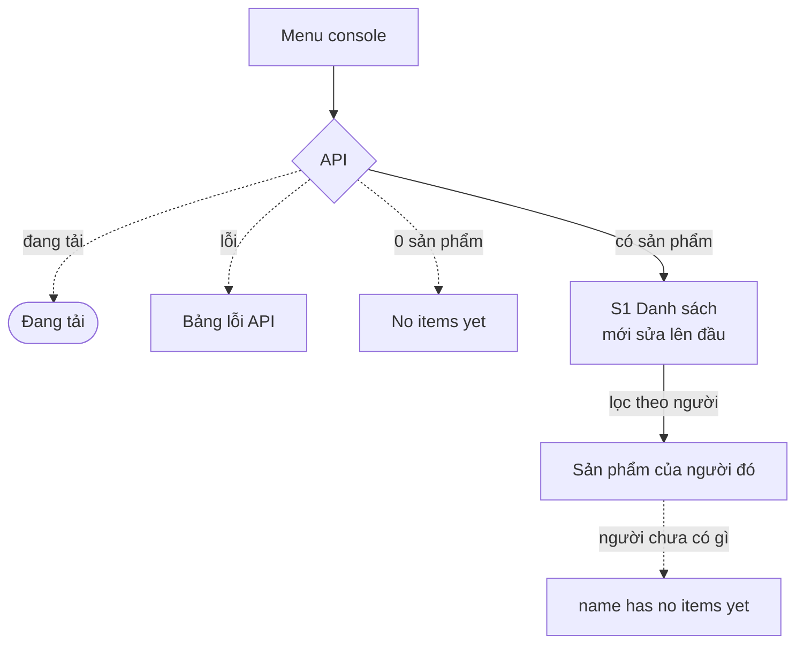

#### F1a · Thêm sản phẩm

Owner thêm một sản phẩm (console).

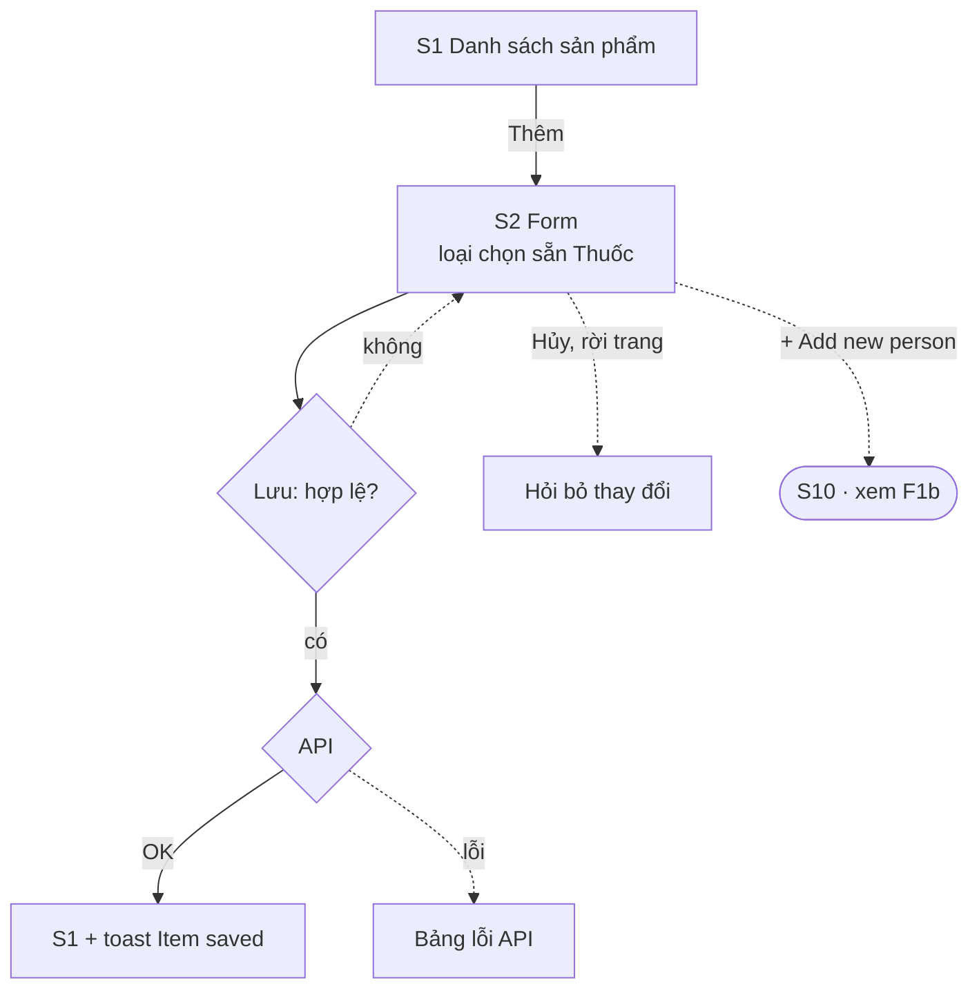

#### F1b · Thêm người trong form

Owner thêm người ngay trong form sản phẩm ('S10 Hộp tên người').

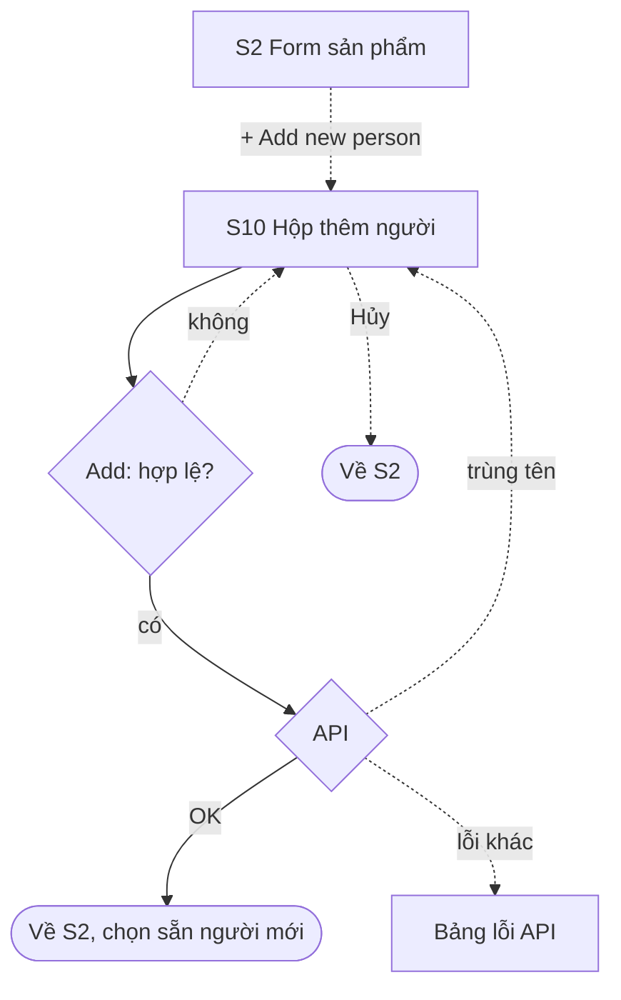

Ngoài sơ đồ:
- Chọn loại Vật tư thì vẫn ở 'S2 Form sản phẩm'.
- Danh sách người trong 'S2 Form sản phẩm' đang tải hoặc tải lỗi: theo bảng lỗi API.
- Bấm "Save" hai lần thì chỉ một sản phẩm được tạo. Nút "Add" ở 'S10 Hộp tên người' cũng khóa trong lúc gửi.
- Trùng tên với một sản phẩm khác của cùng người thì vẫn lưu, không cảnh báo.
- Người vừa tạo ở 'S10 Hộp tên người' vẫn còn, kể cả khi Owner hủy form sản phẩm sau đó. Chấp nhận [Owner].
- Lỗi 403 hoặc 500 đóng luôn 'S10 Hộp tên người', vì console đóng mọi hộp thoại (bảng lỗi API).

#### F2 · Sửa sản phẩm

Owner sửa một sản phẩm (console).

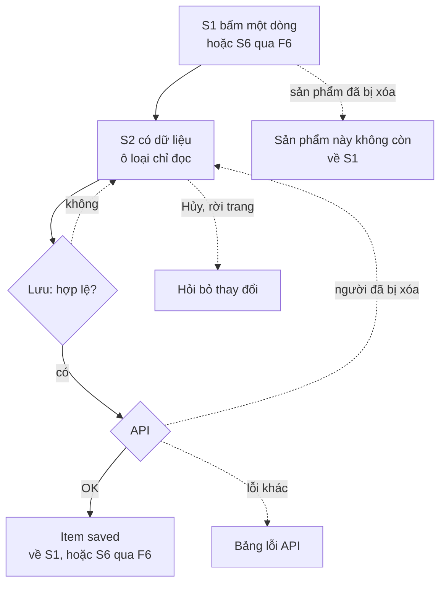

Lỗi theo ô khi lưu: như 'F1a Thêm sản phẩm'. Sửa cùng một sản phẩm ở hai thiết bị: lần lưu sau ghi đè, không báo; chấp nhận vì chỉ có một người dùng. [Owner]

#### F3 · Xóa sản phẩm

Owner xóa một sản phẩm (console).

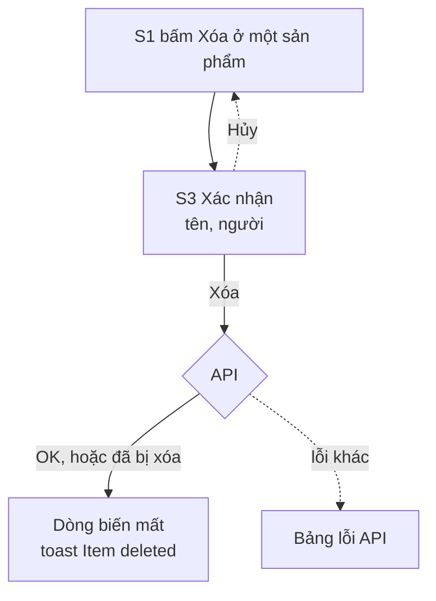

Sản phẩm đã bị xóa ở nơi khác (tab khác, thiết bị khác) cũng coi như xóa xong. Nút "Delete" khóa trong lúc gửi, nên bấm hai lần chỉ gửi một lần.

#### F4 · Quản lý người

Owner quản lý người (console).

##### F4a · Thêm hoặc đổi tên người

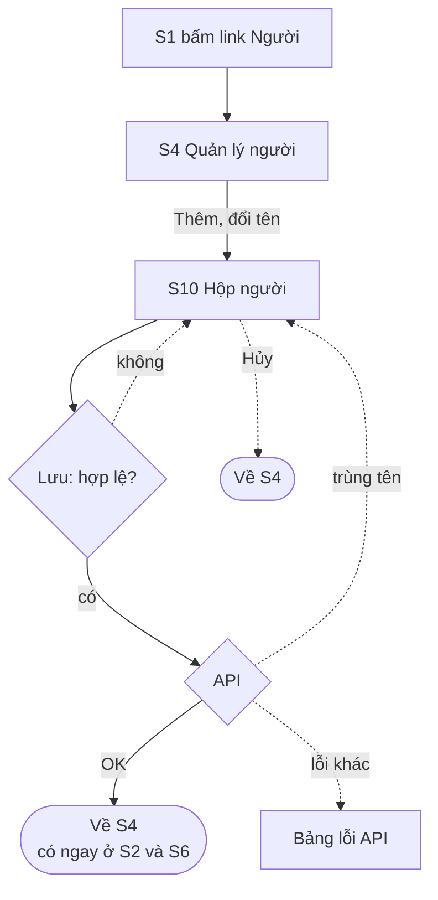

##### F4b · Xóa người

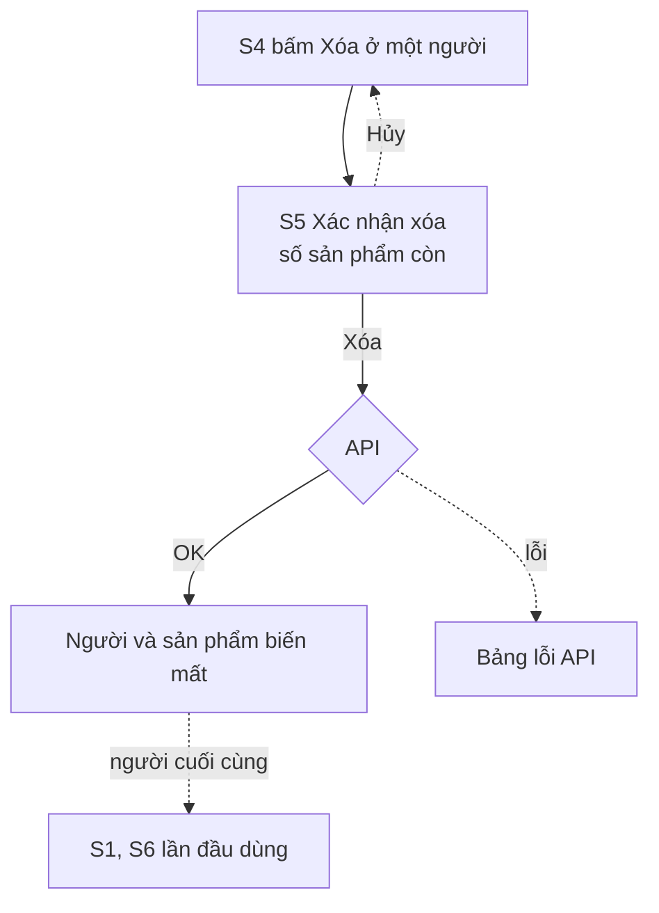

Ngoài sơ đồ:
- Thêm và đổi tên dùng chung 'S10 Hộp tên người', cũng là hộp mà form sản phẩm mở ('F1b Thêm người trong form'). Thêm thì ô tên trống; đổi tên thì ô tên điền sẵn tên cũ.
- Tên không hợp lệ hoặc trùng thì 'S10 Hộp tên người' vẫn mở, tên đã gõ còn nguyên, lỗi hiện ở ô tên.
- Đổi tên chỉ khác hoa thường ("Mẹ" thành "mẹ") là cùng một người, nên được lưu.

#### F5 · Tra cứu

Owner tra cứu (landing, thường trên điện thoại).

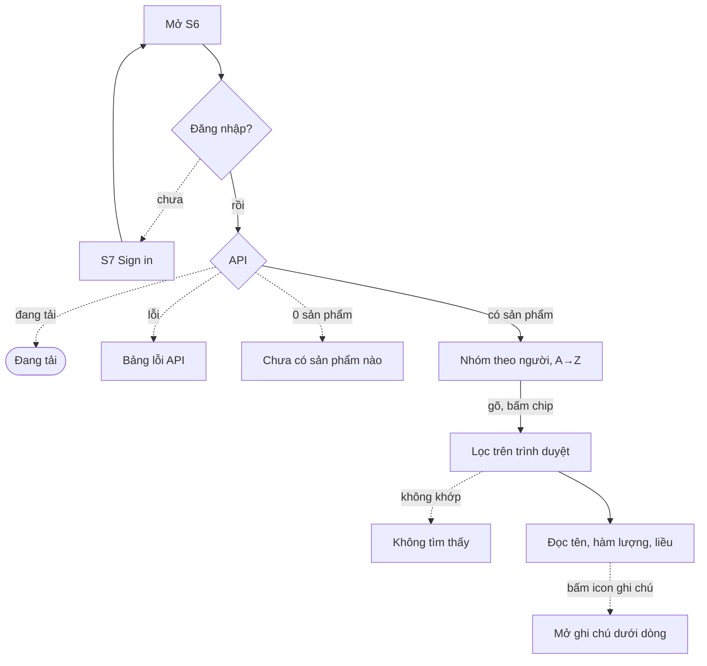

Mất mạng nằm ngoài phạm vi ('E3 Scope'); trang đã tải xong thì vẫn lọc được.

#### F6 · Sửa từ tra cứu

Owner sửa từ trang tra cứu, rồi quay lại.

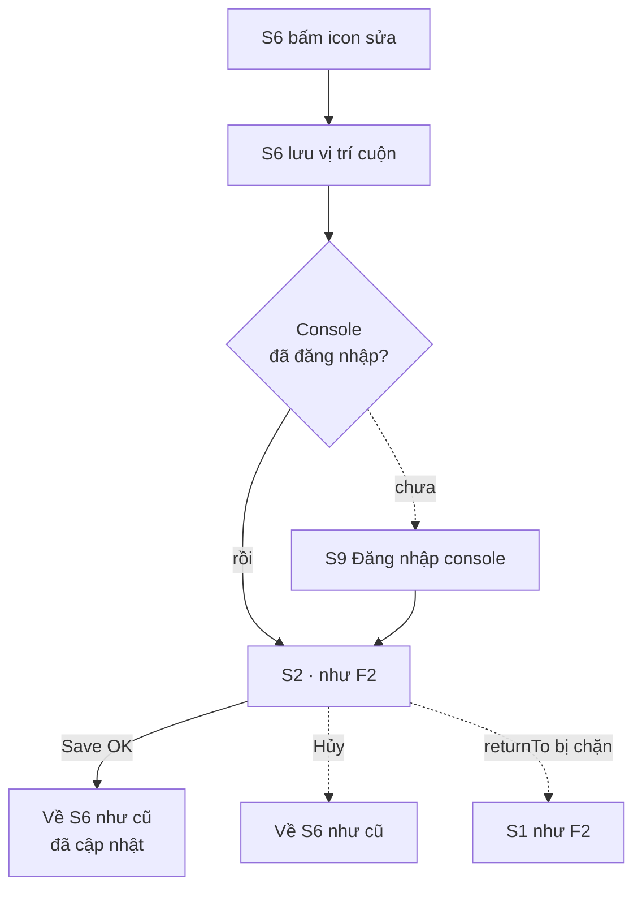

Cách làm [Owner]:
- Từ khóa và chip đang chọn đã nằm trên URL của 'S6 Trang tra cứu' (SR-008) [Q-42]. Trước khi rời trang, S6 chỉ lưu vị trí cuộn vào `sessionStorage`.
- Icon sửa mở 'S2 Form sản phẩm' kèm tham số `returnTo` là URL đầy đủ của 'S6 Trang tra cứu', gồm cả từ khóa và chip.
- Lưu hoặc hủy ở 'S2 Form sản phẩm' thì console chuyển về `returnTo`. 'S6 Trang tra cứu' đọc từ khóa và chip từ URL, tải lại dữ liệu và cuộn về chỗ cũ.
- Console chỉ chấp nhận `returnTo` thuộc landing. Giá trị khác bị bỏ qua (chặn open redirect).
- Qua 'S9 Đăng nhập console' vẫn giữ được `returnTo`, vì `authGuard` của console đưa cả URL (kèm tham số) vào `returnUrl` của trang đăng nhập.

Icon sửa hiện cả trên điện thoại [Q-20]; các màn hình console của module này responsive [Owner], bố cục trên điện thoại theo [Q-43].

#### F7 · Chuẩn bị mang đi

Owner chuẩn bị đồ mang đi xa.

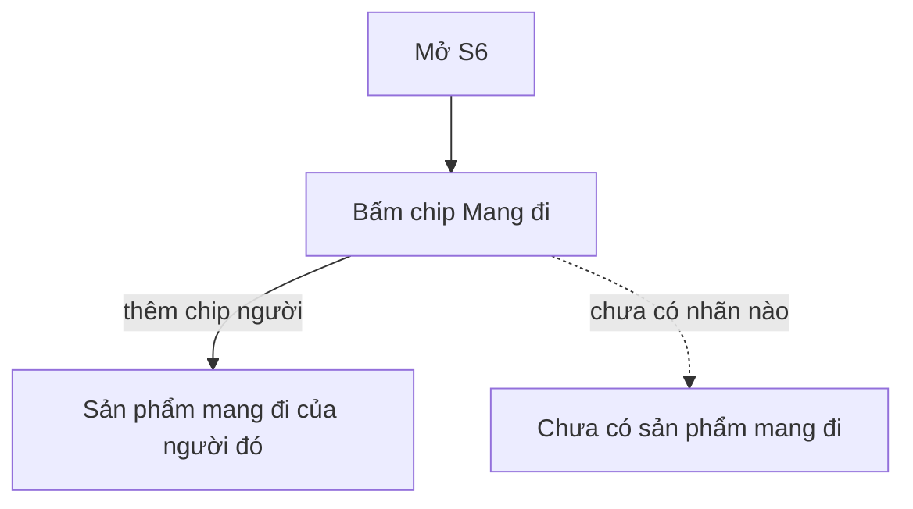

Owner xem danh sách rồi tự đối chiếu với đồ đang có; trang không có ô tick hay đánh dấu đã gom [Owner].

### Data dictionary

Trạng thái: [Owner]

| Field | Meaning | Type | Format, example | Required | Limits | Label |
|---|---|---|---|---|---|---|
| `HealthProfile.name` | Người được ghi dữ liệu | `string` | "Mẹ" | có | 1–50 ký tự; không trùng, không phân biệt hoa thường [Q-21] | Người |
| `MedicalItem.profileId` | Sản phẩm này của ai | `id` | | có | một người còn tồn tại | Người |
| `MedicalItem.kind` | Thuốc hay vật tư; không đổi được sau khi tạo [Q-13] | `enum` | `MEDICINE` → "Thuốc", `SUPPLY` → "Vật tư" | có, mặc định `MEDICINE` | | Loại |
| `MedicalItem.name` | Tên in trên hộp (tên biệt dược hoặc tên vật tư) | `string` | "Air-X", "Nhiệt kế điện tử" | có | 1–200 ký tự | Tên |
| `MedicalItem.activeIngredients` | Các hoạt chất của thuốc; quyết định tên hiển thị | `string[]` | ["Simethicone"] | không; chỉ thuốc | 0–10 hoạt chất, mỗi hoạt chất 1–100 ký tự | Hoạt chất |
| `MedicalItem.strength` | Lượng hoạt chất trong **một đơn vị** thuốc (một viên, 5ml). Là thông tin của sản phẩm, giống nhau với mọi người | `string` | "500mg", "10mg/5ml" | có, với thuốc [Q-12] | 1–50 ký tự | Hàm lượng |
| `MedicalItem.dose` | Lượng **mỗi lần dùng** và số lần trong ngày. Là thông tin của người dùng, Owner và mẹ có thể khác nhau | `string` | "2 viên x 3 lần/ngày" | không; chỉ thuốc | 0–100 ký tự | Liều |
| `MedicalItem.timing` | Uống lúc nào so với bữa ăn; chi tiết khác ghi vào ghi chú [Q-22] | `enum` | `BEFORE_MEAL` → "Trước ăn", `AFTER_MEAL` → "Sau ăn", `WITH_MEAL` → "Trong bữa ăn", `ANY_TIME` → "Lúc nào cũng được" | không; chỉ thuốc | | Thời điểm uống |
| `MedicalItem.usageType` | Dùng lâu dài hay theo đợt | `enum` | `LONG_TERM` → "Dùng lâu dài", `COURSE` → "Dùng theo đợt" | không; chỉ thuốc | | Cách dùng |
| `MedicalItem.purpose` | Dùng cho bệnh hoặc triệu chứng gì; được tìm | `string` | "Đầy hơi, đau dạ dày" | không | 0–500 ký tự | Mục đích |
| `MedicalItem.packForTravel` | Sản phẩm này mang theo khi đi xa | `boolean` | | có, mặc định `false` | | Mang đi |
| `MedicalItem.note` | Mọi điều khác, kể cả "không hợp" hoặc "chưa rõ kết quả" [Q-3]; không được tìm | `string` | "Không hợp: nổi mẩn sau 2 ngày" | không | 0–2000 ký tự | Ghi chú |
| `createdAt`, `updatedAt` | Hệ thống tự ghi [Q-7] | `datetime` | | hệ thống | | Cập nhật |

Hàm lượng và liều dễ nhầm: hàm lượng đi theo hộp thuốc ("500mg" mỗi viên), liều đi theo người ("2 viên" mỗi lần). Ở 'S6 Trang tra cứu', field áp dụng mà chưa ghi hiện "Chưa ghi"; vật tư nằm trong bảng con riêng, không có cột của thuốc [Q-40] (bảng câu chữ, S6).

### Permission matrix

Trạng thái: [Owner]

Bảng tra J6.

| Role | Xem trang tra cứu (S6) | Gọi API đọc | Tạo, sửa, xóa sản phẩm | Quản lý người |
|---|---|---|---|---|
| Owner (`ADMIN`, đã đăng nhập) | có | có | có | có |
| `USER` đã đăng nhập | trang mở, dữ liệu 403 | không | không (console: `adminGuard` đưa về trang chủ) | không |
| Chưa đăng nhập | không | không | không | không |
| Machine token (token của radar; token riêng cho slice 2) | — (token không mở trang) | không | không | không |

Không áp dụng: sơ đồ trạng thái (sản phẩm chỉ có còn và đã xóa), thứ tự gọi giữa các hệ thống (chỉ một API), sự kiện analytics ('E2 Done and measure' đo bằng tay, xem Observability), audit (để epic audit trail, xem History).

### Mockup

Bỏ qua [Owner]. Bảng màn hình và bảng câu chữ dưới đây thay cho mockup; các cột của chế độ dòng trên điện thoại (phần còn lại của Q-18) chốt khi làm slice 1.

### Câu chữ theo trạng thái

Trạng thái: [Owner]

Mục 3.7 của checklist, bảng tra J4.

Console viết bằng tiếng Anh như phần còn lại của console. Landing có hai ngôn ngữ, đi qua `LANDING_COPY` (VI / EN). `{name}` là tên người, `{item}` là tên hiển thị của sản phẩm, `{n}` là số sản phẩm.

| Screen | State | Câu chữ hiện ra | Người dùng làm gì tiếp |
|---|---|---|---|
| 'S1 Danh sách sản phẩm' | đang tải | chỉ báo đang tải theo component có sẵn của console, không có chữ | chờ |
| 'S1 Danh sách sản phẩm' | lần đầu dùng | "No items yet" · "Add the medicines and supplies your family has used." · nút "Add item" | bấm "Add item" → 'S2 Form sản phẩm' |
| 'S1 Danh sách sản phẩm' | rỗng (lọc theo người) | "{name} has no items yet" · nút "Clear filter", nút "Add item" | bỏ lọc, hoặc thêm sản phẩm |
| 'S1 Danh sách sản phẩm' | lỗi | theo bảng lỗi API (trang lỗi 403 hoặc 500, toast "Network error") | theo trang lỗi |
| 'S2 Form sản phẩm' | đang tải (khi sửa) | chỉ báo đang tải theo component có sẵn của console | chờ |
| 'S2 Form sản phẩm' | lần đầu dùng (chưa có người) | ô Person trống, chỉ có dòng "+ Add new person" | thêm người ngay trong ô |
| 'S2 Form sản phẩm' | lỗi theo ô | "Person is required" · "Name is required" · "Strength is required" · "Maximum {max} characters" · "Maximum 10 active ingredients" | sửa ô có lỗi, bấm "Save" lại |
| 'S2 Form sản phẩm' | sản phẩm đã bị xóa | "This item no longer exists" · nút "Back to list" | về 'S1 Danh sách sản phẩm' |
| 'S2 Form sản phẩm' | người đã bị xóa (ở tab khác) | "This person no longer exists" ở ô Person | chọn người khác, bấm "Save" lại |
| 'S2 Form sản phẩm' | rời trang khi chưa lưu | hộp chung `UnsavedChangesDialog` (ở lại, bỏ, lưu) | chọn một trong ba |
| 'S3 Hộp xóa sản phẩm' | xác nhận | tiêu đề "Delete item?" · "Delete {item} of {name}? This cannot be undone." · nút "Delete" | xóa hoặc hủy |
| 'S4 Trang người' | lần đầu dùng | "No people yet" · "Add a person to start recording items." · nút "Add person" | bấm "Add person" → 'S10 Hộp tên người' |
| 'S10 Hộp tên người' | mở để thêm | tiêu đề "Add person" · ô "Name" trống · nút "Add", nút "Cancel" | gõ tên, bấm "Add" |
| 'S10 Hộp tên người' | mở để đổi tên | tiêu đề "Rename person" · ô "Name" điền sẵn tên cũ · nút "Save", nút "Cancel" | sửa tên, bấm "Save" |
| 'S10 Hộp tên người' | lỗi theo ô | "Name is required" · "Maximum 50 characters" · "A person with this name already exists"; hộp vẫn mở | sửa tên |
| 'S5 Hộp xóa người' | xác nhận, người còn sản phẩm | tiêu đề "Delete {name}?" · "{name} has {n} items. They will be deleted too." · nút "Delete all" | xóa hoặc hủy |
| 'S5 Hộp xóa người' | xác nhận, người chưa có sản phẩm | tiêu đề "Delete {name}?" · "{name} has no items." · nút "Delete" | xóa hoặc hủy |
| 'S6 Trang tra cứu' | đang tải | chỉ báo đang tải theo component có sẵn của landing | chờ |
| 'S6 Trang tra cứu' | lần đầu dùng | "Chưa có sản phẩm nào" / "No items yet" · "Thêm sản phẩm ở console." / "Add items in the console." · link "Mở console" / "Open console" | mở console |
| 'S6 Trang tra cứu' | không có kết quả | "Không tìm thấy sản phẩm nào" / "No matching items" · "Thử từ khóa khác hoặc bỏ chip lọc." / "Try another keyword or clear the filters." · nút "Xóa bộ lọc" / "Clear filters" | đổi từ khóa, bỏ chip |
| 'S6 Trang tra cứu' | chưa có sản phẩm mang đi | "Chưa có sản phẩm mang đi" / "No travel items yet" · "Gắn nhãn Mang đi cho sản phẩm ở console." / "Tag items as Travel in the console." · link "Mở console" / "Open console" | mở console, gắn nhãn |
| 'S6 Trang tra cứu' | có dữ liệu | Tiêu đề nhóm: "{name} · {n} sản phẩm" / "{name} · {n} items" · tiêu đề bảng con: "Thuốc" / "Medicines", "Vật tư" / "Supplies" · nhãn của icon ghi chú (cho trình đọc màn hình): "Xem ghi chú" / "Show note", khi đang mở: "Ẩn ghi chú" / "Hide note" | tìm, lọc, bấm icon ghi chú |
| 'S6 Trang tra cứu' | sản phẩm thiếu thông tin | Field áp dụng mà chưa ghi hiện "Chưa ghi" / "Not recorded", ở cả chế độ dòng và mini card. Bảng con "Vật tư" chỉ có cột của field chung, nên không có ô trống của field thuốc [Q-40] | đọc tiếp |
| 'S6 Trang tra cứu' | lỗi (500, mất mạng) | "Không tải được" / "Couldn't load items" · nút "Thử lại" / "Retry" | bấm "Thử lại" |
| 'S6 Trang tra cứu' | không có quyền (role `USER`) | "Tài khoản này không xem được trang này" / "This account can't view this page" · không có nút "Thử lại" | đăng nhập bằng tài khoản Owner |
| 'S8 Toast' | thành công | toast "Item saved" · "Item deleted" · "Person saved" · "Person deleted" | đọc, toast tự tắt |
| 'S8 Toast' | lỗi | toast theo bảng lỗi API | theo bảng |

'S7 Sign in của landing' và 'S9 Đăng nhập console' là trang có sẵn, giữ câu chữ hiện tại. Nhãn của các field trong form lấy từ cột Label của data dictionary, dịch sang tiếng Anh khi làm (ví dụ "Hàm lượng" → "Strength").

## E6 · Rules and examples *(logic)* · Phase 4

Mỗi quy tắc có một dòng in nghiêng ghi flow và màn hình nó phủ. Nhãn cuối tên quy tắc là nguồn của quy tắc; cột Source là nguồn của từng example. Expected `?` chờ câu hỏi trong 'E0 Questions'. Không có R15: nhãn "Cần mua" đã bỏ. 'R16 Quay lại tra cứu' tách từ 'R6 Field ở tra cứu' sau review phase 4. Owner chốt từng quy tắc; dòng nào sai thì sửa hoặc xóa.

Quy tắc ở đây chỉ ghi phần riêng của tủ thuốc. Hành vi đến từ pattern hoặc convention có sẵn nằm ở **Hành vi kế thừa** (P1–P13): mỗi pattern một dòng, không viết lại example. Số example đã bỏ không dùng lại, để các chỗ trích dẫn không đổi nghĩa.

### Rules

#### R1 · Tên hiển thị
**Tên hiển thị: đúng một hoạt chất thì hiện tên hoạt chất, còn lại hiện tên thuốc [Q-2]**
*'F5 Tra cứu', 'F3 Xóa sản phẩm' · 'S6 Trang tra cứu', 'S3 Hộp xóa sản phẩm'*

| Example | Given | When | Expected (incl. what the user sees next) | Source |
|---|---|---|---|---|
| R1.1 | Thuốc "Air-X", hoạt chất ["Simethicone"] | Mở 'S6 Trang tra cứu' | Tên chính "Simethicone"; dòng phụ "Air-X" | [Q-2], [Q-35] |
| R1.2 | Thuốc "Panadol Extra", hoạt chất ["Paracetamol", "Caffeine"] | Mở 'S6 Trang tra cứu' | Tên chính "Panadol Extra"; dòng phụ "Paracetamol + Caffeine" | [Q-2], [Q-35] |
| R1.3 | Thuốc "Men tiêu hóa X", chưa nhập hoạt chất | Mở 'S6 Trang tra cứu' | Tên chính "Men tiêu hóa X"; không có dòng phụ, vì chưa có hoạt chất | [Q-2], [Q-35] |
| R1.4 | Vật tư "Nhiệt kế điện tử" | Mở 'S6 Trang tra cứu' | Tên chính "Nhiệt kế điện tử", nhãn "Vật tư"; không có dòng phụ | [Q-2], [Q-35], [Q-38] |
| R1.6 | "Air-X" (hoạt chất "Simethicone") của Owner | Ở 'S1 Danh sách sản phẩm' bấm Delete | 'S3 Hộp xóa sản phẩm': tiêu đề "Delete item?" · "Delete Simethicone of Owner? This cannot be undone." · nút "Delete" | [E5 câu chữ S3] |

#### R2 · Field theo loại
**Vật tư không có các field của thuốc; API là nơi kiểm; không đổi loại sau khi tạo. Đổi loại lúc tạo theo 'P8 Đổi loại' [E4, Q-13]**
*'F1a Thêm sản phẩm', 'F2 Sửa sản phẩm' · 'S2 Form sản phẩm'*

| Example | Given | When | Expected | Source |
|---|---|---|---|---|
| R2.2 | Gọi API tạo vật tư "Băng gạc" kèm `dose: "1 miếng"` | Gửi | 400, lỗi ở field `dose`; không có gì được lưu | [E4] |
| R2.3 | Đang sửa một thuốc có liều "2 viên" | Nhìn form sửa | Ô loại chỉ đọc, không đổi được; muốn thành vật tư thì xóa sản phẩm rồi tạo sản phẩm mới | [Q-13] |
| R2.4 | Gọi API `PATCH` một thuốc kèm `kind: "SUPPLY"` | Gửi | 400, lỗi ở field `kind`; không có gì thay đổi | [Q-13] |

#### R3 · Field bắt buộc
**Field bắt buộc: người, tên, loại (mặc định Thuốc); thuốc bắt buộc thêm hàm lượng, ghi ở ô riêng [Q-12]**
*'F1a Thêm sản phẩm', 'F2 Sửa sản phẩm' · 'S2 Form sản phẩm', 'S6 Trang tra cứu', 'S8 Toast'*

| Example | Given | When | Expected | Source |
|---|---|---|---|---|
| R3.1 | Form có người "Mẹ", loại "Thuốc", tên "Atorvastatin", hàm lượng "10mg" | Bấm "Save" | Toast "Item saved", về 'S1 Danh sách sản phẩm', sản phẩm nằm đầu danh sách; không có bước nháp nên sản phẩm có ngay ở 'S6 Trang tra cứu', các field áp dụng chưa ghi hiện "Chưa ghi" | [Q-12], [Owner] |
| R3.2 | Form để trống tên | Bấm "Save" | Ô Name báo "Name is required"; không gửi; dữ liệu ở các ô khác còn nguyên; Owner điền tên rồi bấm "Save" lại | [Q-12], [E5 câu chữ S2] |
| R3.3 | Thuốc "Atorvastatin", để trống hàm lượng | Bấm "Save" | Ô Strength báo "Strength is required"; không gửi | [Q-12], [E5 câu chữ S2] |
| R3.4 | Vật tư "Nhiệt kế điện tử", không có ô hàm lượng | Bấm "Save" | Toast "Item saved", về 'S1 Danh sách sản phẩm' | [Q-12], R2 |
| R3.5 | Mở form tạo sản phẩm mới | Nhìn ô loại | Đã chọn sẵn "Thuốc" | [Q-12] |
| R3.6 | Thuốc bôi "Kem Z" hàm lượng "1%", ghi chú "Không hợp: nổi mẩn sau 2 ngày" | Bấm "Save", rồi ở 'S6 Trang tra cứu' bấm icon ghi chú của "Kem Z" | Toast "Item saved"; ở S6 ghi chú "Không hợp: nổi mẩn sau 2 ngày" mở ngay dưới dòng | [Q-3], [Q-41] |
| R3.7 | Mẹ đã có "Paracetamol" 500mg | Thêm cho Mẹ "Paracetamol" 250mg, bấm "Save" | Lưu được, không cảnh báo; danh sách có hai sản phẩm | [Q-17] |
| R3.8 | Thuốc mới "Siro ho Y" hàm lượng "100ml", ghi chú "Đã dùng, chưa rõ kết quả" | Bấm "Save", rồi ở 'S6 Trang tra cứu' bấm icon ghi chú của "Siro ho Y" | Toast "Item saved"; ở S6 thấy ghi chú "Đã dùng, chưa rõ kết quả" | [Q-3], [E3] |

#### R4 · Tìm kiếm
**Tìm theo tên, hoạt chất, mục đích; không tìm trong ghi chú. Cách khớp theo 'P11 Khớp một phần', từ khóa trên URL theo 'P12 Lọc trên URL' [E4, Owner]**
*'F5 Tra cứu' · 'S6 Trang tra cứu'*

| Example | Given | When | Expected | Source |
|---|---|---|---|---|
| R4.1 | Sản phẩm có mục đích "Đau dạ dày" | Gõ "da day" | Sản phẩm hiện trong kết quả | [E4] |
| R4.2 | Thuốc "Air-X", hoạt chất "Simethicone" | Gõ "SIMETHICON" | Sản phẩm hiện trong kết quả (khớp hoạt chất) | [E4] |
| R4.3 | Ở nhà thuốc nơi khác, chỉ biết hoạt chất | Gõ "simethicone" | Thấy "Air-X" của mình; đưa hoạt chất cho dược sĩ | [E3] |
| R4.4 | Ghi chú có chữ "uống sau ăn", không field nào khác có | Gõ "sau an" | Không ra sản phẩm đó (ghi chú không được tìm) | [E5 data dictionary] |
| R4.5 | Không sản phẩm nào khớp "xyz" | Gõ "xyz" | "Không tìm thấy sản phẩm nào" · "Thử từ khóa khác hoặc bỏ chip lọc." · nút "Xóa bộ lọc" | [E5 câu chữ S6] |
| R4.9 | Thuốc "Air-X" | Gõ "AIR-X" | Sản phẩm hiện trong kết quả (khớp tên biệt dược) | [E3] |
| R4.10 | Chỉ có sản phẩm mục đích "Đầy hơi"; Owner chỉ biết triệu chứng "nhức đầu" | Gõ "nhuc dau", rồi bấm "Xóa bộ lọc" | Trước: "Không tìm thấy sản phẩm nào". Sau khi bấm: ô tìm trống, không chip nào được chọn, danh sách đầy đủ, xếp A→Z trong từng bảng con | [E5 câu chữ S6], [Q-16], [R6.7], [Owner] |

#### R5 · Nhóm theo người
**Mặc định thấy mọi sản phẩm của mọi người, nhóm theo người; chip lọc theo một người [Owner]**
*'F5 Tra cứu' · 'S6 Trang tra cứu'*

| Example | Given | When | Expected | Source |
|---|---|---|---|---|
| R5.1 | Owner có 5 sản phẩm, Mẹ có 3 sản phẩm | Mở 'S6 Trang tra cứu' | Hai nhóm theo tên người A→Z: nhóm "Mẹ" rồi nhóm "Owner"; đầu mỗi nhóm có tên người và số sản phẩm (3 và 5); mỗi nhóm có bộ dòng (hoặc bộ card) riêng, không trộn lẫn | [Owner], [Q-39] |
| R5.2 | Như R5.1 | Bấm chip "Mẹ" | Chỉ còn nhóm "Mẹ" với 3 sản phẩm | [Owner] |
| R5.3 | Chip "Mẹ" đang chọn | Gõ "simethicone" | Chỉ thấy sản phẩm của Mẹ có khớp | [E4] |
| R5.4 | Owner và Mẹ đều dùng Simethicone, liều khác nhau | Gõ "simethicone" | Hai nhóm, mỗi nhóm một sản phẩm với đúng liều của người đó | [E3], [Owner] |
| R5.5 | Có "Simethicone" (sửa hôm qua) và "Atorvastatin" (sửa tuần trước) | Mở 'S6 Trang tra cứu', chưa gõ gì | Trong nhóm của người đó, "Atorvastatin" đứng trước "Simethicone" (A→Z theo tên hiển thị) | [Q-16] |
| R5.6 | Một người có "Dầu gió Z", "Đường glucose", "Zinc" | Mở 'S6 Trang tra cứu', chưa gõ gì | Thứ tự: "Dầu gió Z", "Đường glucose", "Zinc" ("Đ" đứng sau "D") | [Q-37] |
| R5.7 | Chip "Mẹ" đang chọn, Mẹ không có "Atorvastatin" | Gõ "atorvastatin", rồi bấm "Xóa bộ lọc" | Trước: "Không tìm thấy sản phẩm nào". Sau khi bấm: bỏ cả chip lẫn từ khóa, thấy lại hai nhóm với đủ 8 sản phẩm | [E5 câu chữ S6] |
| R5.8 | Chip "Mẹ" đang chọn | Bấm chip "Owner", rồi bấm lại chip "Owner" | Lần đầu: chip "Owner" thay chip "Mẹ", chỉ còn nhóm "Owner". Lần sau: bỏ chọn, thấy lại hai nhóm | [Q-30] |
| R5.9 | Có người "Bố" chưa có sản phẩm nào | Mở 'S6 Trang tra cứu' | Không có chip "Bố" | [Q-31] |
| R5.10 | Như R5.1; Mẹ không có sản phẩm nào khớp "atorvastatin" | Gõ "atorvastatin" | Chỉ còn nhóm "Owner"; nhóm "Mẹ" ẩn | [Q-39] |

#### R6 · Field ở tra cứu
**Ở 'S6 Trang tra cứu', thuốc hiện bộ field của thuốc (hàm lượng, liều, thời điểm uống, cách dùng), vật tư chỉ hiện bộ field của vật tư, như form; field trống hiện theo bảng câu chữ [E3, Owner]**
*'F5 Tra cứu' · 'S6 Trang tra cứu'*

| Example | Given | When | Expected | Source |
|---|---|---|---|---|
| R6.1 | Thuốc "Atorvastatin", thời điểm uống `AFTER_MEAL` | Mở 'S6 Trang tra cứu' | Sản phẩm có nhãn "Sau ăn" | [Q-22] |
| R6.2 | Thuốc mỡ máu, cách dùng `LONG_TERM` | Mở 'S6 Trang tra cứu' | Sản phẩm có nhãn "Dùng lâu dài" | [Q-5] |
| R6.4 | Thuốc "Atorvastatin", hàm lượng "10mg", liều "1 viên x 1 lần/ngày" | Mở 'S6 Trang tra cứu' ở chế độ dòng | Dòng hiện "10mg" và "1 viên x 1 lần/ngày" | [E5 F5] |
| R6.5 | Thuốc có ghi chú "Không hợp: nổi mẩn sau 2 ngày" | Mở 'S6 Trang tra cứu' ở chế độ dòng, bấm icon ghi chú, rồi bấm lần nữa | Dòng có icon ghi chú, không hiện nội dung. Bấm lần đầu: ghi chú mở ngay dưới dòng. Bấm lần nữa: ghi chú đóng | [Q-41] |
| R6.6 | Thuốc "Atorvastatin" chưa ghi liều | Mở 'S6 Trang tra cứu' ở chế độ dòng | Cột liều hiện "Chưa ghi" | [Owner] |
| R6.7 | Mẹ có thuốc "Atorvastatin" và vật tư "Nhiệt kế điện tử" | Mở 'S6 Trang tra cứu' ở chế độ dòng | Nhóm "Mẹ" có hai bảng con: "Thuốc" (có cột hàm lượng, liều, thời điểm uống, cách dùng) rồi "Vật tư" (chỉ có cột của field chung, không có "Chưa ghi"); người chỉ có thuốc thì không có bảng con "Vật tư" | [Owner], [Q-40] |
| R6.8 | Như R6.5, R6.6, R6.7 | Mở 'S6 Trang tra cứu' ở chế độ mini card | Giống chế độ dòng: field áp dụng chưa ghi hiện "Chưa ghi"; card vật tư chỉ có các field chung; bấm icon ghi chú thì ghi chú mở trong card | [Q-33], [Owner], [Q-41] |
| R6.9 | Thuốc "Atorvastatin" không có ghi chú | Mở 'S6 Trang tra cứu' | Dòng không có icon ghi chú | [Q-41] |
| R6.10 | Thuốc "Amoxicillin", cách dùng `COURSE` | Mở 'S6 Trang tra cứu' | Sản phẩm có nhãn "Dùng theo đợt" | [E5 data dictionary] |

#### R7 · Xóa có xác nhận
**Xóa trên UI là xóa hẳn, có xác nhận; database soft delete [Q-9, Q-11]**
*'F3 Xóa sản phẩm', 'F4b Xóa người' · 'S1 Danh sách sản phẩm', 'S3 Hộp xóa sản phẩm', 'S4 Trang người', 'S5 Hộp xóa người', 'S6 Trang tra cứu', 'S8 Toast'*

| Example | Given | When | Expected | Source |
|---|---|---|---|---|
| R7.1 | Sản phẩm "Air-X" của Owner | Ở 'S1 Danh sách sản phẩm' bấm Delete, ở 'S3 Hộp xóa sản phẩm' bấm "Delete" | Toast "Item deleted"; sản phẩm biến mất khỏi S1 và 'S6 Trang tra cứu'; database còn dòng với `deletedAt` | [Q-9], [E5 F3] |
| R7.2 | Như R7.1 | Ở 'S1 Danh sách sản phẩm' bấm Delete, ở 'S3 Hộp xóa sản phẩm' bấm "Cancel" | Hộp đóng; S1 không đổi | [Q-9] |
| R7.3 | Người "Mẹ" còn 3 sản phẩm | Ở 'S4 Trang người' bấm Delete | 'S5 Hộp xóa người': tiêu đề "Delete Mẹ?" · "Mẹ has 3 items. They will be deleted too." · nút "Delete all" | [Q-11], [E5 câu chữ S5] |
| R7.4 | Như R7.3 | Bấm "Delete all" | Toast "Person deleted"; Mẹ và 3 sản phẩm biến mất khỏi 'S4 Trang người', 'S1 Danh sách sản phẩm', 'S6 Trang tra cứu'; chip "Mẹ" không còn | [Q-11], [E5 câu chữ S8] |
| R7.5 | Người "Bố" chưa có sản phẩm nào | Ở 'S4 Trang người' bấm Delete | 'S5 Hộp xóa người': tiêu đề "Delete Bố?" · "Bố has no items." · nút "Delete" | [E5 câu chữ S5] |
| R7.6 | Chỉ còn người "Owner", có 2 sản phẩm | Xóa "Owner", bấm "Delete all" | Toast "Person deleted"; 'S4 Trang người' hiện "No people yet"; 'S1 Danh sách sản phẩm' hiện "No items yet"; 'S6 Trang tra cứu' hiện "Chưa có sản phẩm nào"; ô Person của form tạo chỉ còn "+ Add new person" | [E5 F4b], P2 |

#### R8 · Giữ dữ liệu trong phiên
**Dữ liệu sức khỏe không ra khỏi phiên của Owner: chặn machine token, không có trong HTML render ở server. Phân quyền chung theo 'P1 Phân quyền ADMIN' [E4]**
*'F5 Tra cứu', mọi endpoint · 'S6 Trang tra cứu'*

| Example | Given | When | Expected | Source |
|---|---|---|---|---|
| R8.5 | Gọi bằng machine token của radar | Gọi bất kỳ endpoint nào của module | 401, vì token không phải JWT nên `JwtAccessGuard` từ chối; token của radar không đọc được dữ liệu sức khỏe | [E4 Security] |
| R8.6 | Owner đã đăng nhập | Server trả 'S6 Trang tra cứu' | Response có header `noindex`; HTML render ở server không chứa dữ liệu sản phẩm (dữ liệu chỉ tải ở trình duyệt) | [E4 Security] |

Ô "không" của token riêng ở slice 2 có example khi làm slice 2.

#### R9 · Chế độ xem
**Chế độ xem: dòng (mặc định) hoặc mini card; trang nhớ lựa chọn [Q-14]**
*'F5 Tra cứu' · 'S6 Trang tra cứu'*

| Example | Given | When | Expected | Source |
|---|---|---|---|---|
| R9.1 | Lần đầu mở 'S6 Trang tra cứu' | Nhìn danh sách | Sản phẩm hiện dạng dòng (row/table) | [Q-14] |
| R9.2 | Đang ở chế độ dòng | Chọn mini card, đóng trang, mở lại | Sản phẩm hiện dạng mini card | [Q-14] |
| R9.3 | Trên điện thoại đã chọn mini card | Mở 'S6 Trang tra cứu' trên desktop lần đầu | Desktop hiện dạng dòng; mỗi thiết bị nhớ riêng | [Q-15] |

#### R10 · Thứ tự ở console
**Danh sách sản phẩm ở console: sản phẩm sửa gần nhất lên đầu, lọc được theo người. Khác thứ tự A→Z của trang tra cứu, vì hai app phục vụ hai việc khác nhau [Owner]**
*'F0 Mở danh sách', 'F1a Thêm sản phẩm', 'F2 Sửa sản phẩm', 'F3 Xóa sản phẩm' · 'S1 Danh sách sản phẩm'*

| Example | Given | When | Expected | Source |
|---|---|---|---|---|
| R10.1 | Danh sách có 5 sản phẩm | Lưu một sản phẩm mới | Toast "Item saved"; sản phẩm mới nằm đầu danh sách | [Owner] |
| R10.2 | Owner có 5 sản phẩm, Mẹ có 3 sản phẩm | Chọn lọc "Mẹ" | Thấy 3 sản phẩm của Mẹ | [E5 F0] |
| R10.3 | Lọc "Mẹ" đang chọn, Mẹ chưa có sản phẩm nào | Nhìn danh sách | "Mẹ has no items yet", nút "Clear filter" và nút "Add item" | [E5 câu chữ S1] |
| R10.4 | 5 sản phẩm, "Atorvastatin" nằm cuối | Bấm "Atorvastatin", đổi liều, bấm "Save" | Toast "Item saved", về 'S1 Danh sách sản phẩm', "Atorvastatin" lên đầu danh sách | [Owner] |
| R10.5 | "Air-X" đang mở ở hai thiết bị | Máy A lưu liều "1 viên", sau đó máy B lưu liều "2 viên" | Cả hai lần lưu đều được, không cảnh báo; 'S6 Trang tra cứu' hiện "2 viên" | [E5 F2] |
| R10.6 | Owner có thuốc "Air-X" (hoạt chất "Simethicone"), có nhãn "Mang đi" | Mở 'S1 Danh sách sản phẩm' | Dòng có tên chính "Simethicone" và dòng phụ "Air-X", rồi các cột Person "Owner", Type "Medicine", Travel, Updated; nút Delete ở cuối dòng. Bấm dòng thì mở 'S2 Form sản phẩm' | [Q-44] |
| R10.7 | Số sản phẩm nhiều hơn một trang | Mở 'S1 Danh sách sản phẩm' | Danh sách phân trang như trang Tags; trang không có ô tìm | [Q-45] |
| R10.8 | Lọc "Mẹ" đang chọn | Tải lại trang | URL vẫn có `?person=` của Mẹ; danh sách vẫn chỉ có sản phẩm của Mẹ | [Q-45], SR-008 |

#### R11 · Quản lý người
**Người: quản lý ở 'S4 Trang người'; thêm và đổi tên qua 'S10 Hộp tên người', mở được từ S4 hoặc form sản phẩm; tên không trùng (không phân biệt hoa thường, bỏ qua người đã xóa theo 'P9 Trùng tên') [Q-8, Q-21, Owner]**
*'F1b Thêm người trong form', 'F4a Thêm hoặc đổi tên người' · 'S2 Form sản phẩm', 'S4 Trang người', 'S6 Trang tra cứu', 'S8 Toast', 'S10 Hộp tên người'*

| Example | Given | When | Expected | Source |
|---|---|---|---|---|
| R11.1 | Có "Owner", "Mẹ" | Ở 'S4 Trang người' bấm "Add person", gõ "Bố", bấm "Add" | Hộp đóng, toast "Person saved"; "Bố" có trong S4, trong ô Person của 'S2 Form sản phẩm' và trong chip ở 'S6 Trang tra cứu' | [Q-8], [E5 F4a] |
| R11.2 | Đã có "Mẹ" | Ở 'S10 Hộp tên người' gõ "mẹ", bấm "Add" | Lỗi "A person with this name already exists" ở ô tên; hộp S10 vẫn mở, ô tên vẫn là "mẹ"; không lưu | [Q-21], [E5 F4a] |
| R11.3 | "Mẹ" có 3 sản phẩm | Ở 'S4 Trang người' bấm đổi tên "Mẹ": 'S10 Hộp tên người' mở với tiêu đề "Rename person", ô Name điền sẵn "Mẹ"; sửa thành "Má", bấm "Save" | Toast "Person saved"; 3 sản phẩm và chip ở 'S6 Trang tra cứu' hiện "Má" | [Q-8], [E5 câu chữ S10] |
| R11.4 | Đang điền form sản phẩm, chưa có "Bố" | Ở ô Person chọn "+ Add new person", gõ "Bố", bấm "Add" | "Bố" được tạo và chọn sẵn trong ô Person; dữ liệu đã điền trong form còn nguyên | [Owner] |
| R11.5 | Đã có "Mẹ" | Đổi tên "Mẹ" thành "mẹ" | Lưu được (cùng một người, chỉ khác hoa thường) | [Q-21], [E5 F4] |
| R11.6 | Đã có "Mẹ" và "Bố" | Đổi tên "Bố" thành "mẹ" | API trả 409; lỗi "A person with this name already exists" ở ô tên; 'S10 Hộp tên người' vẫn mở, ô tên vẫn là "mẹ"; không lưu | [Q-21] |
| R11.9 | Form sản phẩm đã điền, mở 'S10 Hộp tên người' từ ô Person | Bấm "Cancel" ở S10 | Về 'S2 Form sản phẩm'; form còn nguyên, ô Person không đổi | [E5 F1b] |
| R11.10 | Mở 'S10 Hộp tên người' từ 'S4 Trang người' | Bấm "Cancel" | Về S4; không có gì thay đổi | [E5 F4a] |
| R11.11 | Ở form tạo, đã thêm "Bố" qua 'S10 Hộp tên người' | Bấm "Cancel" ở form sản phẩm, chọn bỏ thay đổi | Sản phẩm không được tạo; "Bố" vẫn còn ở 'S4 Trang người' | [Owner] |
| R11.12 | Có "Owner", "Mẹ", "Bố" | Mở 'S4 Trang người', rồi mở ô Person của 'S2 Form sản phẩm' | Cả hai nơi xếp "Bố", "Mẹ", "Owner" (A→Z theo tiếng Việt) | [Q-46] |

R12 không còn: đã gom vào 'P2 Trạng thái màn hình' (bảng câu chữ 3.7).

#### R13 · Ghi ở console
**Ghi ở console: nút gửi khóa trong lúc gửi; sản phẩm hoặc người đã bị xóa ở nơi khác thì feature tự xử lý, vì console không có xử lý chung cho 404. Lỗi API khác theo 'P3 Lỗi API', bỏ thay đổi theo 'P4 Hỏi bỏ thay đổi', phiên theo 'P6 Phiên đăng nhập' [E5 bảng lỗi API]**
*'F1a Thêm sản phẩm', 'F1b Thêm người trong form', 'F2 Sửa sản phẩm', 'F3 Xóa sản phẩm', 'F4a Thêm hoặc đổi tên người', 'F4b Xóa người' · 'S1 Danh sách sản phẩm', 'S2 Form sản phẩm', 'S3 Hộp xóa sản phẩm', 'S4 Trang người', 'S5 Hộp xóa người', 'S10 Hộp tên người'*

| Example | Given | When | Expected | Source |
|---|---|---|---|---|
| R13.3 | Form đã điền đủ | Bấm "Save" hai lần liên tiếp | Chỉ một sản phẩm được tạo; nút "Save" khóa trong lúc gửi. Nút "Delete" ở 'S3 Hộp xóa sản phẩm', nút "Delete" và "Delete all" ở 'S5 Hộp xóa người', nút "Add" và "Save" ở 'S10 Hộp tên người' cũng vậy | [E5 F1b, F3] |
| R13.4 | Sản phẩm "Air-X" đã bị xóa | Mở link sửa của sản phẩm đó | "This item no longer exists" · nút "Back to list"; bấm thì về 'S1 Danh sách sản phẩm'. Console không có xử lý chung cho 404, feature tự làm | [E5 bảng lỗi API] |
| R13.8 | Form tạo sản phẩm, đã chọn "Bố"; ở tab khác "Bố" bị xóa | Bấm "Save" | API trả 400 ở field `profileId`; ô Person báo "This person no longer exists"; dữ liệu khác còn nguyên; Owner chọn người khác rồi bấm "Save" lại | [E5 câu chữ S2] |
| R13.9 | Sản phẩm "Air-X" đã bị xóa ở thiết bị khác, 'S1 Danh sách sản phẩm' ở máy này chưa tải lại | Bấm Delete "Air-X", bấm "Delete" | API trả 404; coi như đã xóa xong: toast "Item deleted", danh sách tải lại | [E5 F3] |
| R13.10 | Đang sửa sản phẩm của "Bố"; ở tab khác "Bố" bị xóa, nên sản phẩm này bị xóa theo | Bấm "Save" | API trả 404; 'S2 Form sản phẩm' hiện "This item no longer exists" · nút "Back to list" | [Q-11], [E5 bảng lỗi API] |
| R13.11 | "Bố" đã bị xóa ở tab khác, 'S4 Trang người' ở tab này chưa tải lại | Bấm Delete ở "Bố", bấm "Delete" | API trả 404; coi như đã xóa xong: toast "Person deleted", S4 tải lại | [Q-47] |
| R13.12 | Như R13.11 | Bấm đổi tên "Bố", sửa tên, bấm "Save" | API trả 404; 'S10 Hộp tên người' đóng, toast "This person no longer exists", S4 tải lại | [Q-47] |

#### R14 · Nhãn Mang đi
**Nhãn "Mang đi": lọc ra danh sách mang đi khi chuẩn bị đi xa [Owner]**
*'F7 Chuẩn bị mang đi', 'F1a Thêm sản phẩm', 'F2 Sửa sản phẩm' · 'S2 Form sản phẩm', 'S6 Trang tra cứu'*

| Example | Given | When | Expected | Source |
|---|---|---|---|---|
| R14.1 | 8 sản phẩm, 3 sản phẩm có nhãn "Mang đi" | Bấm chip "Mang đi" | Thấy 3 sản phẩm đó | [Owner] |
| R14.2 | Như R14.1, 1 trong 3 sản phẩm là của Mẹ | Bấm thêm chip "Mẹ" | Thấy 1 sản phẩm | [Owner] |
| R14.3 | Chưa sản phẩm nào có nhãn "Mang đi" | Bấm chip "Mang đi" | "Chưa có sản phẩm mang đi" · "Gắn nhãn Mang đi cho sản phẩm ở console." · link "Mở console" | [E5 câu chữ S6] |
| R14.4 | Mở form tạo sản phẩm mới | Nhìn ô "Mang đi" | Chưa chọn | [Owner] |
| R14.5 | "Air-X" chưa có nhãn | Ở 'S2 Form sản phẩm' bật "Mang đi", bấm "Save"; mở 'S6 Trang tra cứu', bấm chip "Mang đi" | Toast "Item saved"; ở S6 "Air-X" có trong danh sách mang đi | [Owner] |
| R14.6 | Như R14.1, 1 trong 3 sản phẩm là "Air-X" (Simethicone) | Bấm chip "Mang đi", gõ "simethicone" | Thấy 1 sản phẩm | [E4] |
| R14.7 | Owner có sản phẩm mang đi, Mẹ không có | Bấm chip "Mang đi" và chip "Mẹ" | "Không tìm thấy sản phẩm nào" · nút "Xóa bộ lọc"; "Chưa có sản phẩm mang đi" chỉ hiện khi không ai có nhãn | [Q-32] |

#### R16 · Quay lại tra cứu
**Sửa từ trang tra cứu rồi quay lại đúng chỗ cũ [Owner]**
*'F6 Sửa từ tra cứu', 'F2 Sửa sản phẩm' · 'S6 Trang tra cứu', 'S2 Form sản phẩm', 'S9 Đăng nhập console', 'S1 Danh sách sản phẩm'*

| Example | Given | When | Expected | Source |
|---|---|---|---|---|
| R16.1 | Bất kỳ sản phẩm nào, console đã đăng nhập | Ở 'S6 Trang tra cứu' bấm icon sửa | Mở 'S2 Form sản phẩm' của sản phẩm đó | [E4] |
| R16.2 | Mở 'S6 Trang tra cứu' trên điện thoại | Nhìn một sản phẩm | Icon sửa vẫn hiện; bấm thì mở 'S2 Form sản phẩm', form dùng được trên điện thoại | [Q-20], [Owner] |
| R16.3 | Liều của "Simethicone" ghi sai. Ở 'S6 Trang tra cứu' đã gõ "simethicone", chọn chip "Mẹ", cuộn xuống sản phẩm thứ 8 | Bấm icon sửa, sửa liều, bấm "Save" | Về S6: URL vẫn có từ khóa "simethicone" và chip "Mẹ", đúng vị trí cuộn; sản phẩm hiện liều mới | [Owner], [E3], [Q-42] |
| R16.4 | Như R16.3 | Bấm icon sửa, rồi bấm "Cancel" (không sửa gì) | Về 'S6 Trang tra cứu' với trạng thái như cũ | [Owner] |
| R16.5 | Như R16.3 | Bấm icon sửa, đổi liều, bấm "Cancel" | Hộp `UnsavedChangesDialog` hiện ra. "bỏ": về 'S6 Trang tra cứu' như cũ, liều không đổi. "ở lại": vẫn ở 'S2 Form sản phẩm', liều đã sửa còn. "lưu": lưu, rồi về S6 như cũ | [E5 F6, pattern chung] |
| R16.6 | Mở link sửa với `returnTo=https://evil.example` | Bấm "Save" | Console bỏ qua `returnTo`, về 'S1 Danh sách sản phẩm' như 'F2 Sửa sản phẩm' | [E5 F6] |
| R16.7 | Console chưa đăng nhập | Ở 'S6 Trang tra cứu' bấm icon sửa, đăng nhập ở 'S9 Đăng nhập console', sửa liều, bấm "Save" | Về S6 như cũ | [E5 F6] |
| R16.8 | Đang ở 'S2 Form sản phẩm' qua 'F6 Sửa từ tra cứu'; phiên hết hạn và làm mới phiên thất bại | Bấm "Save" | Hộp bỏ thay đổi hiện ra, rồi về trang đăng nhập console; đăng nhập xong về trang chủ console, không về 'S6 Trang tra cứu' | [E5 bảng lỗi API] |
| R16.9 | Sản phẩm đã bị xóa ở thiết bị khác, 'S6 Trang tra cứu' chưa tải lại | Bấm icon sửa | 'S2 Form sản phẩm' hiện "This item no longer exists"; nút "Back to list" về S6 với trạng thái cũ (vì `returnTo` hợp lệ) | [Q-34] |
| R16.10 | Ở 'S6 Trang tra cứu' đã gõ "simethicone"; "Air-X" là sản phẩm khớp duy nhất | Bấm icon sửa, xóa hoạt chất "Simethicone", bấm "Save" | Về S6 với từ khóa "simethicone"; "Air-X" không còn khớp nên không hiện; S6 hiện "Không tìm thấy sản phẩm nào" | [E5 F6], R4 |

### Hành vi kế thừa

Trạng thái: [Owner]
*F0–F7 · S1–S11 · ma trận phân quyền · bảng lỗi API · responsive*

Mỗi dòng là một pattern hoặc convention có sẵn. Feature không viết lại example cho chúng; feature chỉ phải gắn đúng pattern, và smoke test của dòng đó bắt lỗi quên gắn. Khi một quyết định trong epic thành convention mới: ghi vào `style-review.md`, đưa vào file chuẩn, rồi thay các example của nó bằng một dòng ở đây.

| ID | Tên ngắn | Pattern | Nguồn | Áp dụng ở | Smoke test của feature |
|---|---|---|---|---|---|
| P1 | Phân quyền ADMIN | Phân quyền ADMIN: API dùng `JwtAccessGuard` + `RoleGuard` + `@Roles(['ADMIN'])`; landing private area chuyển sang Sign in ('S7 Sign in của landing'); console `adminGuard` | E4 Security, E5 ma trận phân quyền | mọi endpoint, S6, S7, S1–S5 | E2E API: mỗi ô "không" của ma trận (chưa đăng nhập → 401, role `USER` → 403) |
| P2 | Trạng thái màn hình | Trạng thái màn hình (lần đầu dùng, rỗng theo lọc, đang tải, lỗi, không có quyền) dùng component có sẵn của từng app, câu chữ và nút bước tiếp theo theo bảng 3.7 | E5 bảng câu chữ 3.7 | S1, S2, S4, S6 | Component: mỗi dòng của bảng 3.7 hiện đúng câu chữ và nút |
| P3 | Lỗi API | Lỗi API ở console: 400 hiện ở ô (`ServerErrorDirective` + mã `_VALIDATION_ERROR`), 403 và 500 đóng hộp thoại rồi sang 'S11 Trang lỗi console', 429 và mất mạng thành toast; landing hiện "Không tải được" kèm "Thử lại" | E5 bảng lỗi API, `patterns-error-handling.md` | S1–S6, S10, S11 | Integration: một lỗi 400 hiện ở đúng ô; `HEALTH_PROFILE_NAME_TAKEN` có trong từ điển lỗi |
| P4 | Hỏi bỏ thay đổi | Hỏi bỏ thay đổi: `unsavedChangesGuard` + `UnsavedChangesDialog` (ở lại, bỏ, lưu) | E5 pattern chung | S2 | Unit: route của 'S2 Form sản phẩm' có `unsavedChangesGuard` |
| P5 | Hộp thoại chung | Hộp xác nhận, hộp thoại, thông báo: `ConfirmDialog`, `MatDialog`, `ToastService` | E5 pattern chung | S3, S5, S8, S10 | Không cần: component chung đã có test |
| P6 | Phiên đăng nhập | Phiên hết hạn và role sai ở console: `refreshInterceptor` tự làm mới phiên; làm mới thất bại thì về 'S9 Đăng nhập console' không kèm trang đang ở | Q-19, E5 bảng lỗi API | S1–S5, S10 | Chạy tay một lần |
| P7 | Nhớ chế độ xem | Chế độ xem nhớ theo thiết bị (`localStorage`) | Q-14, Q-15 | S6 | Gộp vào 'R9 Chế độ xem' |
| P8 | Đổi loại | SR-004: đổi loại thì hiện bộ field của loại mới, ẩn và xóa bộ field cũ; màn hình đọc cũng theo bộ field của loại | `design/cookbook/forms.md` | S2, S6 | Component: đổi Thuốc → Vật tư → Thuốc, các ô của thuốc trống |
| P9 | Trùng tên | SR-005: kiểm tra trùng chỉ xét bản ghi chưa xóa | `patterns-architecture.md` | S10, API người | Integration: thêm lại tên của người đã xóa thì lưu được |
| P10 | Trim | SR-006: trim hai đầu trước mọi kiểm tra; chuỗi chỉ có khoảng trắng là rỗng; ô rỗng trong danh sách hoạt chất bị bỏ | `patterns-architecture.md` | mọi ô chữ ở S2, S10 | Unit (schema): tên "   " bị từ chối; "Mẹ " trùng với "Mẹ" |
| P11 | Khớp một phần | SR-007: tìm khớp một phần, không phân biệt hoa thường và dấu, "đ" coi như "d". Hàm chuẩn hóa chung chưa có; module này tạo nó trong `@portfolio/shared/utils` (không dùng hàm của slug, vì hàm đó xóa "đ") | `patterns-architecture.md` | S6 | Unit: bộ lọc của 'S6 Trang tra cứu' dùng hàm chuẩn hóa chung ("sime", "dau" ra kết quả) |
| P12 | Lọc trên URL | SR-008: từ khóa và chip lọc nằm trên URL, cập nhật bằng `replaceUrl` | `patterns-architecture.md` | S6, F6 | Component: gõ từ khóa thì URL có `?q=`; tải lại trang vẫn giữ |
| P13 | Responsive | Responsive foundation: 4 breakpoint (mobile, tablet, laptop, wide), mixins `respond-to`, `currentBp()`; module này là màn hình console đầu tiên dùng foundation này, shell console giữ hành vi sidebar sẵn có | `design/contracts/responsive-contract.md` | S1–S5, S10 | Chạy tay: 'S1 Danh sách sản phẩm', 'S2 Form sản phẩm', 'S10 Hộp tên người' ở 375px không cuộn ngang, nút bấm được |

### Edge case giá trị (EP + BVA)

Trạng thái: [Owner]

Giới hạn lấy từ data dictionary ở 'E5 Flows and screens'. Trim theo 'P10 Trim'. Độ dài đếm sau khi trim và chuẩn hóa NFC; form và Zod dùng cùng một hàm đếm. Mỗi lỗi hiện ở đúng ô, form không gửi, dữ liệu ở các ô khác còn nguyên; Owner sửa ô đó rồi bấm "Save" lại. Câu chữ theo bảng câu chữ 'S2 Form sản phẩm' và 'S10 Hộp tên người' ở 'E5 Flows and screens'.

| Field | Hợp lệ | Ngay dưới | Tại ranh giới | Ngay trên | Expected khi ra ngoài |
|---|---|---|---|---|---|
| Tên | 1–200 ký tự | 0 (rỗng) | 1 và 200 | 201 | 0: "Name is required" · 201: "Maximum 200 characters" |
| Mỗi hoạt chất | 1–100 ký tự | 0 | 1 và 100 | 101 | 0: hoạt chất bị bỏ, không báo lỗi ('P10 Trim') · 101: "Maximum 100 characters" |
| Số hoạt chất | 0–10 | — | 0 và 10 | 11 | "Maximum 10 active ingredients" |
| Mục đích | 0–500 ký tự | — | 0, 1 và 500 | 501 | "Maximum 500 characters" |
| Ghi chú | 0–2000 ký tự | — | 0, 1 và 2000 | 2001 | "Maximum 2000 characters" |
| Tên người | 1–50 ký tự | 0 | 1 và 50 | 51 | 0: "Name is required" · 51: "Maximum 50 characters"; 'S10 Hộp tên người' vẫn mở, tên đã gõ còn nguyên |
| Hàm lượng (thuốc) | 1–50 ký tự | 0 | 1 và 50 | 51 | 0: "Strength is required" · 51: "Maximum 50 characters" |
| Liều | 0–100 ký tự | — | 0, 1 và 100 | 101 | "Maximum 100 characters" |

Lớp giá trị không hợp lệ gửi thẳng qua API (EP). Mỗi dòng trả 400 ở đúng field, không có gì được lưu [E5 data dictionary, bảng lỗi API]:

| Field | Lớp không hợp lệ | Ví dụ |
|---|---|---|
| `kind` | ngoài enum, khi tạo | `"FOOD"` |
| `kind` | có mặt trong `PATCH` (R2.4) | `"SUPPLY"` |
| `timing` | ngoài enum | `"MIDNIGHT"` |
| `usageType` | ngoài enum | `"WEEKLY"` |
| `profileId` | không tồn tại hoặc đã bị xóa (R13.8) | một id ngẫu nhiên |
| `packForTravel` | không phải boolean | `"yes"` |

### Non-functional

Trạng thái: [Owner]

- Performance: theo ngưỡng chung của API system, đặt ở một epic riêng; epic này không đặt ngưỡng riêng [Q-36].
- Phân quyền: 'P1 Phân quyền ADMIN', 'R8 Giữ dữ liệu trong phiên'.
- Bảo mật input: Zod ở API; chuỗi người dùng nhập luôn hiển thị dạng text, không qua `innerHTML`.
- Accessibility: mọi ô form có label; chip là nút bật tắt có `aria-pressed`; icon ghi chú là nút có `aria-expanded`, mở bằng Enter hoặc Space; theo chuẩn có sẵn của landing và console.
- History: mọi command của feature kế thừa `BaseCommand` có `userId` ('E4 Design' History); một unit test kiểm tra command tạo sản phẩm mang `userId` của Owner.
- Responsive: 'S6 Trang tra cứu' theo 4 breakpoint của landing; S1–S5 và 'S10 Hộp tên người' theo cùng 4 breakpoint ('P13 Responsive'). Các phần khác của console để sau [Owner].
- Chuỗi giao diện console bằng tiếng Anh, như phần còn lại của console.
- Chuỗi giao diện landing (nhãn, thông báo) đi qua `LANDING_COPY` EN/VI; nội dung sản phẩm là dữ liệu, không dịch.
- Component chung: 'P5 Hộp thoại chung' [Owner].

### Acceptance criteria and test levels

Trạng thái: [Owner]

Feature mới, không có hành vi cũ cần giữ (4.3c bỏ qua). Test viết trước code, mỗi test ghi ID của AC; expected lấy từ example ở trên, không đọc từ code. Cột "Kỹ thuật" theo bảng tra B.

| AC | Rule | WHEN … THE SYSTEM SHALL … | Test level | Kỹ thuật | Example phủ |
|---|---|---|---|---|---|
| AC-1 | R1 | WHEN 'S6 Trang tra cứu' hoặc 'S3 Hộp xóa sản phẩm' hiện một sản phẩm THE SYSTEM SHALL dùng tên hoạt chất làm tên chính khi thuốc có đúng một hoạt chất, còn lại dùng tên sản phẩm, kèm dòng phụ và nhãn "Vật tư" theo Q-35, Q-38 | Unit (policy tên hiển thị) + Component (S3) | decision table (loại × số hoạt chất) | R1.1–R1.4, R1.6 |
| AC-2 | R2 | WHEN API nhận một vật tư có field của thuốc, hoặc `PATCH` có `kind`, THE SYSTEM SHALL trả 400 và không lưu; WHEN sửa một sản phẩm đã có THE SYSTEM SHALL khóa ô loại | Unit (Zod schema) + 1 integration + Component | EP | R2.2–R2.4 |
| AC-3 | R3 | WHEN thiếu field bắt buộc THE SYSTEM SHALL báo lỗi ở ô đó bằng câu chữ của 'S2 Form sản phẩm' và không gửi; WHEN đủ THE SYSTEM SHALL lưu, hiện toast "Item saved" và về 'S1 Danh sách sản phẩm' | Unit (schema) + Component | EP | R3.1–R3.8 |
| AC-4 | R4 | WHEN Owner gõ từ khóa THE SYSTEM SHALL lọc theo tên, hoạt chất, mục đích và không tìm trong ghi chú | Unit (lọc) | EP | R4.1–R4.4, R4.9 |
| AC-5 | R4, R5 | WHEN không sản phẩm nào khớp THE SYSTEM SHALL hiện trạng thái "không có kết quả"; WHEN Owner bấm "Xóa bộ lọc" THE SYSTEM SHALL bỏ cả từ khóa lẫn chip | Component | state transition | R4.5, R4.10, R5.7 |
| AC-6 | R5 | WHEN 'S6 Trang tra cứu' hiện sản phẩm THE SYSTEM SHALL nhóm theo người (tên A→Z, ẩn nhóm rỗng), xếp A→Z theo tên hiển thị trong mỗi nhóm; WHEN Owner chọn chip một người THE SYSTEM SHALL chỉ hiện nhóm đó, bấm lại thì bỏ chọn | Unit (lọc, nhóm, sắp xếp) + Component | EP | R5.1–R5.10 |
| AC-7 | R6 | WHEN 'S6 Trang tra cứu' hiện một sản phẩm THE SYSTEM SHALL hiện đúng bộ field theo loại (thuốc trong bảng con "Thuốc", vật tư trong bảng con "Vật tư"); field áp dụng chưa ghi hiện "Chưa ghi"; icon ghi chú chỉ có khi có ghi chú và mở ghi chú ngay dưới dòng | Component | decision table (loại × field trống × có ghi chú) | R6.1, R6.2, R6.4–R6.10 |
| AC-8 | R7 | WHEN Owner xác nhận xóa một sản phẩm THE SYSTEM SHALL đặt `deletedAt`, hiện toast "Item deleted" và ẩn sản phẩm khỏi 'S1 Danh sách sản phẩm' và 'S6 Trang tra cứu'; WHEN Owner hủy THE SYSTEM SHALL không đổi gì | Unit (handler) + integration + Component | — | R7.1, R7.2 |
| AC-9 | R7 | WHEN Owner xóa một người THE SYSTEM SHALL hỏi kèm số sản phẩm còn lại, và khi xác nhận thì soft delete người đó cùng các sản phẩm | Unit (handler) + Component (S5) | state transition (còn sản phẩm, không còn, người cuối cùng) | R7.3–R7.6 |
| AC-10 | R8 | WHEN request mang machine token THE SYSTEM SHALL trả 401; WHEN server trả 'S6 Trang tra cứu' THE SYSTEM SHALL gửi header `noindex` và không render dữ liệu sản phẩm ở server | E2E (API) + Integration (SSR response) | — | R8.5, R8.6 |
| AC-11 | R9 | WHEN Owner mở 'S6 Trang tra cứu' THE SYSTEM SHALL hiện chế độ xem đã chọn lần trước trên thiết bị đó, mặc định là dòng | Component | — | R9.1–R9.3 |
| AC-12 | R10 | WHEN 'S1 Danh sách sản phẩm' mở THE SYSTEM SHALL xếp sản phẩm sửa gần nhất lên đầu và lọc được theo người; WHEN hai thiết bị cùng lưu THE SYSTEM SHALL giữ lần lưu sau | Unit (query) + Component | — | R10.1–R10.8 |
| AC-13 | R11 | WHEN Owner thêm hoặc đổi tên người qua 'S10 Hộp tên người' THE SYSTEM SHALL lưu khi tên không trùng (không phân biệt hoa thường) rồi hiện toast "Person saved"; nếu trùng THE SYSTEM SHALL giữ hộp mở với tên đã gõ và lỗi ở ô tên | Unit (handler) + Component (S10) | EP | R11.1–R11.3, R11.5, R11.6, R11.12 |
| AC-14 | R11 | WHEN 'S10 Hộp tên người' mở từ form sản phẩm THE SYSTEM SHALL chọn sẵn người mới và giữ nguyên form; WHEN Owner hủy S10 THE SYSTEM SHALL về đúng nơi đã mở | Component | scenario | R11.4, R11.9–R11.11 |
| AC-15 | R13 | WHEN một yêu cầu đang gửi THE SYSTEM SHALL khóa nút gửi; WHEN sản phẩm hoặc người đã bị xóa ở nơi khác THE SYSTEM SHALL xử lý như các example (404 thành "This item no longer exists", xóa lại thì coi như xong, người đã xóa báo ở ô Person) | Integration + Component | state transition | R13.3, R13.4, R13.8–R13.12 |
| AC-16 | R14 | WHEN Owner chọn chip "Mang đi" THE SYSTEM SHALL chỉ hiện sản phẩm có nhãn "Mang đi", kết hợp với chip người và từ khóa; sản phẩm mới chưa có nhãn | Unit (lọc) + Component | EP | R14.1–R14.7 |
| AC-17 | R16 | WHEN Owner sửa từ 'S6 Trang tra cứu' THE SYSTEM SHALL đưa Owner về URL cũ của S6 và vị trí cuộn cũ sau khi lưu hoặc hủy, và chỉ chấp nhận `returnTo` thuộc landing | E2E (landing + console) + Unit (kiểm tra `returnTo`) | scenario | R16.1–R16.10 |
| AC-18 | P1–P13 | WHEN feature gắn một pattern ở bảng Hành vi kế thừa THE SYSTEM SHALL qua smoke test của dòng đó | theo cột Smoke test | decision table cho P1 (role × endpoint) | P1–P13 |
| AC-19 | BVA | WHEN một field ra ngoài ranh giới ở bảng EP + BVA THE SYSTEM SHALL báo lỗi ở đúng field đó bằng câu chữ của bảng | Unit (schema, mỗi ranh giới một case) | BVA | bảng BVA |
| AC-20 | EP | WHEN API nhận một giá trị thuộc lớp không hợp lệ THE SYSTEM SHALL trả 400 ở đúng field và không lưu | Unit (schema) | EP | bảng EP |

Kiểm tay trên điện thoại (không tự động): R4.3 ở nhà thuốc thật, thước đo 'E2 Done and measure' (dưới 1 phút).

### Test design

Trạng thái: [Owner]
*AC-1 đến AC-20 · bảng tra B*

Phần này trả lời ba câu hỏi của bảng tra B, rồi viết các bảng mà cột "Kỹ thuật" của AC cần. Cột Example ghi example đã có; ô `[Owner]` là trường hợp bảng tìm ra mà 'E6 Rules and examples' chưa có example, Owner đã chốt expected ngày 2026-10-28.

#### Sai ở đâu thì đắt

| Mức | Rule | Nếu sai thì | Bao nhiêu là đủ |
|---|---|---|---|
| Cao | R1 tên hiển thị | Owner đọc sai tên ở nhà thuốc, mua nhầm thuốc | Mọi dòng của 'DT-1 Tên hiển thị', ở Unit và Component |
| Cao | R5, R6 nhóm theo người, bộ field | Đọc liều của người khác (R5.4), hoặc thiếu field mà không biết | Mọi dòng của 'DT-2 Field ở tra cứu', chạy ở cả chế độ dòng và mini card |
| Cao | R8, P1 phân quyền | Dữ liệu sức khỏe lộ ra ngoài phiên của Owner | Mọi ô của 'DT-3 Phân quyền', ở E2E API |
| Cao | R7 xóa người | Mất cả sản phẩm của người đó | Mọi dòng của 'ST-2 Xóa người' |
| Cao | R16 `returnTo` | Open redirect | Unit cho mọi giá trị `returnTo` ngoài landing |
| Vừa | R4, R14, P11 tìm và lọc | Không tìm ra, vượt thước đo 'E2 Done and measure' (dưới 1 phút) | Mỗi lớp EP một case, mọi dòng của 'ST-1 Tìm và lọc' |
| Vừa | R3, R11, R13 ghi ở console | Lưu sai hoặc lưu hai lần | Mỗi example một case, mọi dòng của 'ST-3 Bị xóa ở nơi khác' |
| Thấp | R9, R10 | Owner phải bấm thêm một lần | Mỗi example một case |

**Đúng lấy từ đâu:** expected lấy từ example của 'E6 Rules and examples', bảng câu chữ và data dictionary của 'E5 Flows and screens', câu trả lời Q-n. Không lấy từ code.

Không dùng pairwise (không có rule nào có từ 4 tham số độc lập trở lên) và không dùng property-based (hàm chuẩn hóa của 'P11 Khớp một phần' là hàm chung, đã có test riêng).

#### DT-1 · Tên hiển thị
*AC-1 · loại × số hoạt chất*

| Loại | Số hoạt chất | Tên chính | Dòng phụ | Example |
|---|---|---|---|---|
| Thuốc | 0 | tên sản phẩm | không có | R1.3 |
| Thuốc | 1 | tên hoạt chất | tên sản phẩm | R1.1 |
| Thuốc | 2 đến 10 | tên sản phẩm | các hoạt chất nối bằng " + " | R1.2 |
| Vật tư | 0 | tên sản phẩm, nhãn "Vật tư" | không có | R1.4 |
| Vật tư | 1 trở lên | không xảy ra: API trả 400 ở field `activeIngredients`, không lưu ('R2 Field theo loại') | | [Owner] |

#### DT-2 · Field ở tra cứu
*AC-7 · 'S6 Trang tra cứu' · loại × field áp dụng còn trống × có ghi chú*

Mỗi dòng chạy hai lần: chế độ dòng và chế độ mini card (R6.8).

| Loại | Field áp dụng còn trống | Có ghi chú | Expected | Example |
|---|---|---|---|---|
| Thuốc | không | không | bảng con "Thuốc", đủ giá trị, không có icon ghi chú | R6.4, R6.9 |
| Thuốc | không | có | như trên, có icon ghi chú; bấm thì mở dưới dòng, bấm lại thì đóng | R6.5 |
| Thuốc | có (liều) | không | cột liều hiện "Chưa ghi", không có icon | R6.6 |
| Thuốc | có (liều) | có | cột liều hiện "Chưa ghi", có icon ghi chú | [Owner] |
| Vật tư | không | không | bảng con "Vật tư", chỉ có cột của field chung | R6.7 |
| Vật tư | có (mục đích) | có | bảng con "Vật tư", cột mục đích hiện "Chưa ghi", có icon ghi chú | [Owner] |

#### DT-3 · Phân quyền
*'P1 Phân quyền ADMIN', 'R8 Giữ dữ liệu trong phiên' · ai gọi × nhóm endpoint*

| Ai gọi | Đọc sản phẩm, người | Ghi sản phẩm | Ghi người | Trang S6 |
|---|---|---|---|---|
| Chưa đăng nhập | 401 | 401 | 401 | chuyển sang 'S7 Sign in của landing' |
| `USER` | 403 | 403 | 403 | trang mở, hiện "Tài khoản này không xem được trang này" |
| Machine token | 401 (R8.5) | 401 | 401 | — |
| Owner (`ADMIN`) | 200 | 2xx | 2xx | hiện dữ liệu; HTML render ở server không có dữ liệu sản phẩm (R8.6) |

#### ST-1 · Tìm và lọc
*AC-5 · 'S6 Trang tra cứu'*

Mọi lần chuyển trạng thái đều cập nhật URL bằng `replaceUrl` ('P12 Lọc trên URL').

| Đang ở | Owner làm | Sang | Example |
|---|---|---|---|
| Đầy đủ (không lọc) | gõ từ khóa có khớp | Có kết quả | R4.1 |
| Đầy đủ | gõ từ khóa không khớp | Không có kết quả | R4.5 |
| Đầy đủ | bấm chip "Mang đi", chưa có nhãn nào | Chưa có sản phẩm mang đi | R14.3 |
| Có kết quả | bấm chip một người không có sản phẩm khớp | Không có kết quả | R5.7, R14.7 |
| Có kết quả | bấm lại chip đang chọn | bỏ chip, giữ từ khóa | R5.8 |
| Không có kết quả | bấm "Xóa bộ lọc" | Đầy đủ: ô tìm trống, không chip nào được chọn | R4.10, R5.7 |
| Không có kết quả | xóa bớt từ khóa đến khi có khớp | Có kết quả | [Owner] |

#### ST-2 · Xóa người
*AC-9 · 'S4 Trang người', 'S5 Hộp xóa người'*

| Đang ở | Owner làm | Sang | Example |
|---|---|---|---|
| 'S4 Trang người', người còn n sản phẩm | bấm Delete | 'S5 Hộp xóa người' "{name} has {n} items…", nút "Delete all" | R7.3 |
| 'S5 Hộp xóa người', còn n sản phẩm | bấm "Delete all" | người và n sản phẩm có `deletedAt`; toast "Person deleted"; chip người biến mất | R7.4 |
| 'S4 Trang người', người chưa có sản phẩm | bấm Delete | 'S5 Hộp xóa người' "{name} has no items.", nút "Delete" | R7.5 |
| 'S5 Hộp xóa người' | bấm "Cancel" | hộp đóng, 'S4 Trang người' không đổi | [Owner] |
| 'S5 Hộp xóa người', người cuối cùng | bấm "Delete all" | 'S4 Trang người', 'S1 Danh sách sản phẩm', 'S6 Trang tra cứu' về trạng thái lần đầu dùng | R7.6 |
| Người đã xóa | thêm lại người cùng tên qua 'S10 Hộp tên người' | lưu được | P9 |

#### ST-3 · Bị xóa ở nơi khác
*AC-15 · sản phẩm hoặc người bị xóa ở thiết bị hoặc tab khác*

| Màn hình đang mở | Ở nơi khác | Owner làm | Expected | Example |
|---|---|---|---|---|
| 'S2 Form sản phẩm' đang gửi | — | bấm "Save" lần nữa | không gửi lần hai | R13.3 |
| link sửa | sản phẩm bị xóa | mở link | "This item no longer exists" · nút "Back to list" | R13.4 |
| 'S1 Danh sách sản phẩm' chưa tải lại | sản phẩm bị xóa | Delete, rồi "Delete" | 404 coi như xong: toast "Item deleted", danh sách tải lại | R13.9 |
| 'S2 Form sản phẩm' tạo, đã chọn người | người bị xóa | bấm "Save" | 400 ở `profileId`; ô Person báo "This person no longer exists" | R13.8 |
| 'S2 Form sản phẩm' sửa | người bị xóa, sản phẩm bị xóa theo | bấm "Save" | 404; "This item no longer exists" | R13.10 |
| 'S2 Form sản phẩm' sửa | chỉ sản phẩm bị xóa | bấm "Save" | 404; "This item no longer exists" | [Owner] |

## Specialized Skills
- **prisma-migrate**: migration cho `HealthProfile` và `MedicalItem` → slice 1
- **be-test**: test cho module API (handler, schema, quy tắc xóa) → slice 1
- **aqa-expert**: E2E của AC-10 và AC-17 → slice 1
- **ng-lib**: tạo lib feature mới ở console và landing (nếu cần) → slice 1
- **responsive-system**: kiểm tra 'S6 Trang tra cứu' và console theo 'P13 Responsive' → slice 1

## Tasks
- [x] **Slice 1 · Tủ thuốc dùng được: API, console CRUD, trang tra cứu private** · covers F0, F1a, F1b, F2, F3, F4, F4a, F4b, F5, F6, F7 · S1–S11 · AC-1 đến AC-20 [Owner]
  - **Approach:** API và console làm theo khuôn của tag; trang tra cứu làm theo khuôn trang private của checklist. Thứ tự làm là Prisma, shared, API, console, landing, rồi E2E. File theo từng layer, thứ tự làm và test case của từng AC nằm ở [[#Approach của slice 1]]. Owner duyệt đề xuất này trước khi chạy 5.1b.
  - **Progress:** 2026-10-28 breakdown xong. 2026-10-28 Claude đề xuất cách làm (5.1a) và thêm Q-44 đến Q-47 vào E0. 2026-10-28 Owner duyệt Approach. 2026-10-29 5.1b xong phần viết test: mọi file test từ a đến t đã viết và đỏ đúng lý do (thiếu code). Test g, h và q đã chạy với database và dev server. Claude chạy vòng review đầu tiên (một subagent và Codex) và áp dụng các finding đã xác nhận. Owner trả lời D1 (debounce 300 ms có sẵn), Q-48 (API trả 400) và giữ `strictObject`; Claude sửa ghi chú schema trong Approach và thêm test cho Q-48. Owner xác nhận 5.1b xong ngày 2026-10-29. Bước tiếp theo: 5.1c, một session mới viết code cho tới khi mọi test xanh. 2026-10-29 5.1c xong phần code: mọi test của 5.1b xanh, gồm API, api-e2e, console, landing và landing-e2e. Owner duyệt hai lần sửa test: R4.10 xếp A→Z trong từng bảng con, và landing-e2e dùng chung phiên đăng nhập ở localhost với locale `vi-VN`. Claude chạy vòng review hai đợt (Shared và API, rồi Console, Landing và E2E) và sửa các finding đã xác nhận. Owner duyệt D1 (giữ hoạt chất trùng như đã nhập), D2 (S6 dùng component chung của landing) và D3 (thêm test R16.7 và test tên trùng đồng thời). Bước tiếp theo: Owner duyệt các commit theo từng layer trên nhánh `medicine-cabinet-s1`
  - **Test results:** [tầng · kết quả · người ghi; Owner ghi kết quả]
- Slice 2 · Nhập bằng AI: chưa breakdown. Slice này chưa có rule và AC; slice 2 cần chạy phase 2 riêng (machine token như radar, hoặc MCP) [Owner]

### Approach của slice 1

Trạng thái: [Owner]. Owner duyệt cả 7 điểm của mục 'Điểm cần Owner duyệt' ngày 2026-10-28. Các mục còn lại là tài liệu cho session 5.1b và 5.1c; Claude dùng chúng để làm và tự kiểm tra bằng test.

Claude soạn ngày 2026-10-28, sau khi đọc module `tag` của API, lib `feature-tag` của console, lib `feature-checklist` và private area của landing, và `patterns-architecture.md`.

#### Điểm cần Owner duyệt

1. Claude sửa các Zod atom dùng chung ở `zod-atoms.ts` cho đúng SR-006: trim chạy trước `min` và `max`. Việc này đổi hành vi của mọi module đang dùng atom (8 file): một field bắt buộc chỉ có khoảng trắng sẽ bị từ chối, thay vì được lưu thành chuỗi rỗng.
2. Atom có thêm bước chuẩn hóa NFC trước khi đếm, để form và API đếm độ dài giống nhau (bảng EP + BVA). Bước này cũng áp dụng cho mọi module dùng atom. Nếu Owner không muốn đổi rộng như vậy, NFC chỉ áp dụng cho module tủ thuốc.
3. Claude tách phần mở `UnsavedChangesDialog` của `unsavedChangesGuard` thành một hàm dùng chung ở `@portfolio/console/shared/ui`. Form cần hàm này khi Owner bấm "Cancel" để về trang tra cứu, vì lúc đó trình duyệt rời khỏi app console và guard không chạy. Guard cũ giữ nguyên hành vi.
4. Mỗi app có thêm một giá trị cấu hình. Console nhận `landingUrl` để kiểm tra `returnTo`. Landing nhận địa chỉ console cho icon sửa và link "Mở console".
5. API có hai endpoint đọc sản phẩm. `GET items` có phân trang và phục vụ console. `GET lookup` trả mọi sản phẩm một lần và phục vụ landing.
6. Cả hai app dùng URL `/medicine-cabinet`.
7. Hạ tầng test có hai thay đổi. api-e2e thêm một tài khoản `USER`. landing-e2e khởi động thêm console để chạy E2E của AC-17.

#### Code có sẵn được dùng lại

| Cần | Có sẵn ở | Ghi chú |
|---|---|---|
| Khuôn CRUD của API: command, query, Zod trong handler, presenter, repository soft delete | `apps/api/src/modules/tag/` | `findById` của tag đã lọc `deletedAt: null`. Vì vậy xóa lại một sản phẩm đã xóa trả 404 (R13.9), và sửa một sản phẩm đã bị xóa theo người cũng trả 404 (R13.10) |
| Guard cho cả controller | `apps/api/src/modules/checklist/presentation/checklist.controller.ts` | `@UseGuards(JwtAccessGuard, RoleGuard)` và `@Roles(['ADMIN'])` đặt ở class |
| `BaseCommand` có `userId` | `apps/api/src/shared/cqrs/base.command.ts` | Command của tag đã dùng; command của checklist thì không |
| Khuôn của console: list, form, `unsavedChangesGuard`, `ServerErrorDirective`, `ConfirmDialogComponent`, `ToastService` | `libs/console/feature-tag/`, `@portfolio/console/shared/ui`, `@portfolio/console/shared/util` | |
| Trang private của landing: chỉ render ở trình duyệt, header `noindex`, `HttpClient` mang token | `apps/landing/src/app/pages/private/private.routes.ts` | Chỉ cần thêm route vào `PRIVATE_ROUTES`; `NOINDEX_PATHS` và `app.routes.server.ts` tự nhận path mới |
| Service của trang private được provide ở route | `libs/landing/feature-checklist/src/lib/checklist.routes.ts` | Service provide ở root sẽ nhận `HttpClient` không có token, nên mọi lần gọi trả 401 |
| `authGuard` của console giữ URL đầy đủ trong `returnUrl` | `libs/console/shared/data-access/src/lib/guards/auth.guard.ts` | Nhờ vậy `returnTo` qua được trang đăng nhập (R16.7) |
| Breakpoint mixin ở console | `libs/console/shared/ui/src/styles/patterns/_crud.scss` | Đã dùng `respond-down('tablet')` |

Những thứ chưa có, slice này phải tạo hoặc lưu ý:
- Hàm chuẩn hóa để tìm theo SR-007 chưa có trong `@portfolio/shared/utils`.
- Console chưa có chỗ nào đọc tham số `returnTo`.
- Landing chưa biết địa chỉ của console, và console chưa biết địa chỉ của landing. Slice này thêm một giá trị cấu hình cho mỗi app.
- Các Zod atom có sẵn (`NameSchema`, `TagNameSchema`, `requiredShortText`, `optionalShortText` và các atom chuỗi khác) trim **sau** `min(1)`, nên chưa đúng SR-006. Slice này sửa các atom đó (điểm 1 và 2 ở trên).
- api-e2e chỉ có tài khoản `ADMIN`. 'DT-3 Phân quyền' cần thêm một tài khoản `USER` trong `apps/api-e2e/src/support/global-setup.ts`.
- landing-e2e chỉ khởi động API và landing. Test E2E của AC-17 cần thêm console vào `webServer` của `apps/landing-e2e/playwright.config.ts`.

#### File theo layer

**Prisma** (`apps/api/prisma/schema.prisma`; migration chạy qua skill `prisma-migrate`)
- Thêm enum `MedicalItemKind` (`MEDICINE`, `SUPPLY`), `MedicineTiming` (4 giá trị của data dictionary) và `MedicineUsageType` (`LONG_TERM`, `COURSE`).
- Thêm model `HealthProfile` (bảng `health_profiles`) và `MedicalItem` (bảng `medical_items`, khóa ngoại `profileId`). Hai model có đủ cột audit như `Tag` (`createdById`, `updatedById`, `deletedAt`, `deletedById`) và quan hệ ngược ở `User`.
- `activeIngredients` là `String[]`; `packForTravel` là `Boolean @default(false)`.
- Migration có SQL viết tay cho unique index một phần trên `lower(name)` với điều kiện `WHERE "deletedAt" IS NULL` ở `health_profiles` (SR-005, Q-21, Q-28).
- Migration thêm index thường trên `medical_items (profileId, deletedAt)` và `medical_items (updatedAt)`.

**Shared**
- `libs/shared/utils/types/src/lib/medicine-cabinet.types.ts` chứa hằng `MEDICAL_ITEM_KINDS`, `MEDICINE_TIMINGS`, `MEDICINE_USAGE_TYPES` và type của response: `MedicalItemDto`, `HealthProfileDto` (có `itemCount`), `MedicineLookupItem` (có `profileName`). File này theo cách `checklist.types.ts` đang làm.
- `libs/shared/utils/core/src/lib/search-normalize.util.ts` chứa `normalizeForSearch`: chữ thường, NFD, bỏ dấu, rồi đổi `đ` và `Đ` thành `d`. Hàm này export ở cả `index.ts` và `lite.ts`, vì landing không được kéo `hash.util` vào bundle.
- `libs/shared/utils/core/src/lib/medical-item-display.util.ts` chứa `medicalItemDisplay(item)`. Hàm trả tên chính, dòng phụ và cờ vật tư theo 'DT-1 Tên hiển thị'. Hàm export ở `lite.ts`, vì console (S3) và landing (S6) cùng dùng.
- `libs/shared/utils/validation/src/lib/limits.ts` nhận các giới hạn của data dictionary: tên người 50, tên sản phẩm 200, mỗi hoạt chất 100, tối đa 10 hoạt chất, hàm lượng 50, liều 100, mục đích 500, ghi chú 2000.
- `libs/shared/utils/validation/src/lib/zod-atoms.ts`: mọi atom chuỗi chạy theo thứ tự trim, chuẩn hóa NFC, `min` và `max`, rồi `stripHtmlTags`. Test của các module đang dùng atom phải chạy lại. Nếu một test cũ chờ chuỗi chỉ có khoảng trắng được lưu, test đó được sửa theo SR-006.
- Cùng lib validation có thêm hàm đếm `textLength`: trim, chuẩn hóa NFC, rồi đếm. Form console dùng hàm này, nên form và atom đếm giống nhau.
- `libs/shared/utils/errors/src/lib/error-codes/medicine-cabinet.error-codes.ts` chứa `MedicalItemErrorCode` (`NOT_FOUND`, `INVALID_INPUT`) và `HealthProfileErrorCode` (`NOT_FOUND`, `INVALID_INPUT`, `NAME_TAKEN` với giá trị `HEALTH_PROFILE_NAME_TAKEN`).
- `libs/console/shared/util/src/lib/errors/error-dictionary.ts` nhận câu chữ của các mã lỗi mới.
- `libs/shared/utils/enum-labels/src/lib/enum-labels.ts` nhận nhãn tiếng Anh của 3 enum cho console. Nhãn tiếng Việt và tiếng Anh của landing nằm ở `LANDING_COPY`.

**API** (`apps/api/src/modules/medicine-cabinet/`, đăng ký trong `apps/api/src/app/app.module.ts`)
- `domain/entities/health-profile.entity.ts` và `domain/entities/medical-item.entity.ts` có `create`, `update`, `softDelete` theo khuôn `Tag`. `MedicalItem.update` không nhận `kind`.
- `application/health-profile.dto.ts` và `application/medical-item.dto.ts` chứa schema Zod, ghép từ `requiredShortText` và `optionalShortText` đã sửa.
  - Schema tạo sản phẩm là `discriminatedUnion` theo `kind`. Cả hai nhánh dùng `strictObject`, nên API trả 400 cho mọi key lạ thay vì lặng lẽ bỏ qua [Owner].
  - `strictObject` báo key lạ ở path rỗng, không ghi tên field. Vì vậy nhánh `SUPPLY` khai báo rõ các field của thuốc là `z.undefined()`, để lỗi ghi đúng tên field, ví dụ `dose` (R2.2).
  - Schema `PATCH` không có `kind`, cũng là `strictObject`, và khai báo `kind: z.undefined()`, nên lỗi ghi đúng tên `kind` (R2.4).
  - Schema `PATCH` không biết loại đã lưu. Vì vậy handler sửa sản phẩm kiểm tra loại đã lưu: vật tư mà nhận field của thuốc thì trả 400 ở field đó (Q-48).
  - Form console không gửi field của thuốc khi lưu vật tư, kể cả giá trị `null`.
  - Hoạt chất rỗng sau khi trim bị bỏ trước khi đếm số hoạt chất (P10).
- `application/commands/` có 6 command: `create-medical-item`, `update-medical-item`, `delete-medical-item`, `create-health-profile`, `rename-health-profile`, `delete-health-profile`. Mọi command kế thừa `BaseCommand`.
  - Tạo và sửa sản phẩm kiểm tra `profileId` còn tồn tại. Nếu người không còn, handler trả 400 `MEDICAL_ITEM_INVALID_INPUT` ở field `profileId` với câu "This person no longer exists". Nhờ vậy `ServerErrorDirective` hiện lỗi ở ô Person (R13.8).
  - Tạo và đổi tên người kiểm tra trùng tên, không phân biệt hoa thường. Khi đổi tên, handler bỏ qua chính người đang đổi (R11.5). Trùng thì trả 409 `HEALTH_PROFILE_NAME_TAKEN`.
  - Xóa người soft delete người đó và mọi sản phẩm của họ trong cùng một `$transaction` (Q-11).
- `application/queries/` có 4 query.
  - `list-medical-items` phục vụ 'S1 Danh sách sản phẩm': lọc theo `profileId`, xếp `updatedAt` giảm dần, phân trang như tag.
  - `get-medical-item` phục vụ 'S2 Form sản phẩm'.
  - `list-lookup-items` phục vụ 'S6 Trang tra cứu': mọi sản phẩm chưa xóa kèm tên người, không phân trang.
  - `list-health-profiles` trả người kèm `itemCount`, chỉ đếm sản phẩm chưa xóa. 'S5 Hộp xóa người' đọc số này.
- `presentation/medicine-cabinet.controller.ts` dùng `@Controller('medicine-cabinet')` và guard ở class. Các route: `GET` và `POST items`; `GET`, `PATCH` và `DELETE items/:id`; `GET lookup`; `GET` và `POST profiles`; `PATCH` và `DELETE profiles/:id`.
- `infrastructure/` có mapper và repository cho từng entity.

**Console** (`libs/console/feature-medicine-cabinet`, tạo bằng skill `ng-lib`, prefix `console`)
- `medicine-cabinet.routes.ts`: path `''` là 'S1 Danh sách sản phẩm'; `new` và `:id/edit` là 'S2 Form sản phẩm' có `unsavedChangesGuard`; `people` là 'S4 Trang người'.
- `medicine-cabinet.service.ts` gọi các endpoint ở trên.
- `medical-item.list/` là S1. Trang mở 'S3 Hộp xóa sản phẩm' bằng `ConfirmDialogComponent`. Lọc theo người nằm trên URL `?person=` theo SR-008.
- `medical-item.form/` là S2, một form cho cả thuốc và vật tư.
  - Đổi loại thì các field của thuốc bị xóa và ẩn (P8, Q-27).
  - Ô loại chỉ đọc khi sửa.
  - Ô Person có dòng "+ Add new person".
  - Form đọc `returnTo` lúc mở.
- `health-profile.list/` là S4. Trang mở 'S5 Hộp xóa người' bằng `ConfirmDialogComponent`, với câu chữ theo `itemCount`.
- `health-profile.name-dialog/` là S10, một hộp cho cả thêm và đổi tên. Hộp đọc lỗi 409 và đặt lỗi lên ô tên.
- `return-to.util.ts` chứa `safeReturnTo(raw, landingUrl)`. Hàm chỉ nhận URL có cùng origin với landing; giá trị khác trả `null`.
- Về `returnTo` là chuyển trang ra khỏi app console, nên `unsavedChangesGuard` không chạy. Khi Owner bấm "Cancel" mà form có thay đổi, form tự mở `UnsavedChangesDialog` trước khi gọi `location.assign` (R16.5). Claude đề xuất tách phần mở hộp của guard thành một hàm dùng chung trong `@portfolio/console/shared/ui`. Đây là phần thêm vào, guard cũ không đổi hành vi.
- `apps/console/src/environments/*.ts` thêm `landingUrl`. `apps/console/src/app/app.routes.ts` thêm path `medicine-cabinet` dưới `adminGuard`. `libs/console/shared/ui/src/components/main-layout/main-layout.html` thêm mục menu.
- Responsive theo P13 và Q-43: dưới tablet, bảng đổi thành danh sách card bằng `currentBp()`, và SCSS dùng `respond-down('tablet')`.

**Landing** (`libs/landing/feature-medicine-cabinet`, tạo bằng skill `ng-lib`, prefix `landing`)
- `medicine-cabinet.routes.ts` provide `MedicineCabinetService` ở route, như checklist.
- `medicine-cabinet.service.ts` gọi `GET /api/medicine-cabinet/lookup` một lần khi mở trang.
- `medicine-lookup.util.ts` chứa các hàm thuần. Toàn bộ logic lọc nằm ở đây, để test ở mức Unit.
  - `filterLookup` lọc theo từ khóa, chip người và chip "Mang đi".
  - `groupByPerson` nhóm theo người A→Z và bỏ nhóm rỗng.
  - Hai hàm trên sắp xếp bằng `localeCompare('vi')` (Q-37).
  - `personChips` chỉ trả người có sản phẩm (Q-31).
- `medicine-lookup.page/` là S6.
  - Trang đọc và ghi `?q=`, `?person=`, `?travel=1` bằng `replaceUrl` (SR-008).
  - Chế độ xem nằm trong `localStorage`; vị trí cuộn nằm trong `sessionStorage`.
  - Trang hiện mọi trạng thái của bảng câu chữ. Lỗi 403 thành trạng thái "không có quyền".
- `medical-item.lookup-table/` là chế độ dòng, có hai bảng con "Thuốc" và "Vật tư". `medical-item.lookup-card/` là chế độ mini card.
  - Icon ghi chú là nút có `aria-expanded`.
  - Icon sửa dẫn tới trang sửa của console, kèm `returnTo` là URL đầy đủ của S6.
- `apps/landing/src/app/pages/private/private.routes.ts` thêm path `medicine-cabinet`. `libs/landing/shared/ui/src/components/header/header.data.ts` thêm trang vào `workspacePages`.
- `landing-copy.data.ts` nhận mọi chuỗi của S6, đủ EN và VI.
- Landing thêm một giá trị cấu hình cho địa chỉ console.

#### Thứ tự làm

1. Prisma: schema và migration.
2. Shared: sửa Zod atoms; types, limits và `textLength`, error codes, `normalizeForSearch`, `medicalItemDisplay`.
3. API: entity, DTO, command và query, repository, controller.
4. Console: lib và service; S4 và S10; S1 và S3; rồi S2 và `returnTo`.
5. Landing: lib và hàm lọc; S6; rồi icon sửa.
6. E2E: api-e2e cho 'DT-3 Phân quyền'; landing-e2e cho R8.6 và R16; rồi Owner kiểm tay responsive (P13) và R4.3.

Session 5.1b viết test theo cùng thứ tự. Session 5.1c làm cho test của một bước xanh rồi mới sang bước sau.

#### Test case theo AC

Mức test:
- Unit là Jest chạy hàm, schema hoặc handler với repository giả.
- Integration là repository với database thật, như `radar-item.repository.integration.spec.ts`. Riêng AC-2 có một case qua HTTP ở api-e2e.
- Component là Angular TestBed với service giả.
- E2E là api-e2e hoặc Playwright.

Mã file dùng ở cột File của bảng test:

| Mã | File |
|---|---|
| a | `libs/shared/utils/core/src/lib/medical-item-display.util.spec.ts` |
| b | `libs/shared/utils/core/src/lib/search-normalize.util.spec.ts` |
| c | `apps/api/src/modules/medicine-cabinet/application/medical-item.dto.spec.ts` |
| d | `apps/api/src/modules/medicine-cabinet/application/health-profile.dto.spec.ts` |
| e | `apps/api/src/modules/medicine-cabinet/application/commands/medicine-cabinet.commands.spec.ts` |
| f | `apps/api/src/modules/medicine-cabinet/application/queries/medicine-cabinet.queries.spec.ts` |
| g | `apps/api/src/modules/medicine-cabinet/infrastructure/repositories/medicine-cabinet.repository.integration.spec.ts` |
| h | `apps/api-e2e/src/medicine-cabinet/medicine-cabinet.spec.ts` |
| i | `libs/console/feature-medicine-cabinet/src/lib/medical-item.list/medical-item.list.spec.ts` |
| j | `libs/console/feature-medicine-cabinet/src/lib/medical-item.form/medical-item.form.spec.ts` |
| k | `libs/console/feature-medicine-cabinet/src/lib/health-profile.list/health-profile.list.spec.ts` |
| l | `libs/console/feature-medicine-cabinet/src/lib/health-profile.name-dialog/health-profile.name-dialog.spec.ts` |
| m | `libs/console/feature-medicine-cabinet/src/lib/return-to.util.spec.ts` |
| n | `libs/console/feature-medicine-cabinet/src/lib/medicine-cabinet.routes.spec.ts` |
| o | `libs/landing/feature-medicine-cabinet/src/lib/medicine-lookup.util.spec.ts` |
| p | `libs/landing/feature-medicine-cabinet/src/lib/medicine-lookup.page/medicine-lookup.page.spec.ts` |
| q | `apps/landing-e2e/src/medicine-cabinet.spec.ts` |
| r | `apps/landing/src/app/pages/private/private.routes.spec.ts` |
| s | `libs/shared/utils/validation/src/lib/limits.spec.ts` |
| t | `libs/shared/utils/validation/src/lib/zod-atoms.spec.ts` |

| AC | Test case | Example | Mức | File |
|---|---|---|---|---|
| AC-1 | Thuốc có đúng một hoạt chất: tên chính là hoạt chất, dòng phụ là tên sản phẩm | R1.1 | Unit | a |
| AC-1 | Thuốc có hai hoạt chất: tên chính là tên sản phẩm, dòng phụ nối các hoạt chất bằng " + " | R1.2 | Unit | a |
| AC-1 | Thuốc chưa có hoạt chất: tên chính là tên sản phẩm, không có dòng phụ | R1.3 | Unit | a |
| AC-1 | Vật tư: tên chính là tên sản phẩm, có cờ vật tư, không có dòng phụ | R1.4 | Unit | a |
| AC-1 | Vật tư kèm hoạt chất bị 400 ở `activeIngredients` | DT-1 dòng 5 | Unit | c |
| AC-1 | 'S3 Hộp xóa sản phẩm' hiện "Delete Simethicone of Owner? This cannot be undone." | R1.6 | Component | i |
| AC-1 | 'S6 Trang tra cứu' hiện đúng tên chính, dòng phụ và nhãn "Vật tư" ở cả hai chế độ xem | R1.1–R1.4 | Component | p |
| AC-2 | Tạo vật tư kèm `dose` bị 400 ở field `dose` | R2.2 | Unit | c |
| AC-2 | Handler tạo không gọi repository khi schema trả lỗi | R2.2 | Unit | e |
| AC-2 | `POST` vật tư kèm `dose` qua HTTP trả 400, database không có dòng mới | R2.2 | Integration | h |
| AC-2 | `PATCH` kèm `kind: "SUPPLY"` bị 400 ở field `kind` | R2.4 | Unit | c |
| AC-2 | `PATCH` kèm `dose` trên vật tư đã lưu bị 400 ở field `dose`, không lưu | Q-48 | Unit | e |
| AC-2 | Form sửa có ô loại chỉ đọc | R2.3 | Component | j |
| AC-3 | Thuốc đủ người, tên, hàm lượng: Save gọi tạo, toast "Item saved", về S1 | R3.1 | Component | j |
| AC-3 | Tên trống hoặc chỉ có khoảng trắng: ô Name báo "Name is required", không gọi service, ô khác còn nguyên | R3.2, P10 | Component + Unit | j, c |
| AC-3 | Thuốc thiếu hàm lượng: ô Strength báo "Strength is required" | R3.3 | Component + Unit | j, c |
| AC-3 | Vật tư không có hàm lượng: lưu được | R3.4 | Component + Unit | j, c |
| AC-3 | Form tạo chọn sẵn loại "Thuốc" | R3.5 | Component | j |
| AC-3 | Ghi chú "Không hợp: nổi mẩn sau 2 ngày" và "Đã dùng, chưa rõ kết quả" lưu nguyên văn | R3.6, R3.8 | Unit | c |
| AC-3 | Cùng người có hai "Paracetamol" khác hàm lượng: handler không chặn, không cảnh báo | R3.7 | Unit | e |
| AC-4 | `normalizeForSearch` đổi "Đường" thành "duong", "thuốc dạ dày" thành "thuoc da day", và bỏ hoa thường | P11 | Unit | b |
| AC-4 | "da day" khớp mục đích "Đau dạ dày" | R4.1 | Unit | o |
| AC-4 | "SIMETHICON" khớp hoạt chất "Simethicone" | R4.2 | Unit | o |
| AC-4 | "simethicone" ra "Air-X" | R4.3 | Unit | o |
| AC-4 | "sau an" không khớp sản phẩm chỉ có chữ đó trong ghi chú | R4.4 | Unit | o |
| AC-4 | "AIR-X" khớp tên "Air-X" | R4.9 | Unit | o |
| AC-4 | "sime" khớp một phần "Simethicone" | P11 | Unit | o |
| AC-5 | "xyz" hiện "Không tìm thấy sản phẩm nào" kèm nút "Xóa bộ lọc" | R4.5 | Component | p |
| AC-5 | "nhuc dau" rồi "Xóa bộ lọc": ô tìm trống, không chip nào chọn, danh sách đầy đủ A→Z | R4.10 | Component | p |
| AC-5 | Chip "Mẹ" và "atorvastatin" rồi "Xóa bộ lọc": thấy lại hai nhóm với 8 sản phẩm | R5.7 | Component | p |
| AC-5 | Đang không có kết quả, xóa bớt từ khóa đến khi khớp: có kết quả lại | ST-1 dòng 7 | Component | p |
| AC-6 | Owner 5 và Mẹ 3: nhóm "Mẹ" rồi nhóm "Owner", số sản phẩm 3 và 5 | R5.1 | Unit + Component | o, p |
| AC-6 | Chip "Mẹ": chỉ còn nhóm "Mẹ" | R5.2 | Unit | o |
| AC-6 | Chip "Mẹ" và "simethicone": chỉ sản phẩm khớp của Mẹ | R5.3 | Unit | o |
| AC-6 | Owner và Mẹ cùng có Simethicone: hai nhóm, mỗi nhóm giữ liều của người đó | R5.4 | Unit | o |
| AC-6 | Trong nhóm xếp A→Z theo tên hiển thị, không theo `updatedAt` | R5.5 | Unit | o |
| AC-6 | "Dầu gió Z", "Đường glucose", "Zinc" đúng thứ tự tiếng Việt | R5.6 | Unit | o |
| AC-6 | Chip mới thay chip cũ; bấm lại chip đang chọn thì bỏ chọn | R5.8 | Component | p |
| AC-6 | Người chưa có sản phẩm không có chip | R5.9 | Unit | o |
| AC-6 | "atorvastatin": nhóm "Mẹ" không còn sản phẩm khớp thì ẩn | R5.10 | Unit | o |
| AC-7 | Nhãn "Sau ăn", "Dùng lâu dài", "Dùng theo đợt" | R6.1, R6.2, R6.10 | Component | p |
| AC-7 | Dòng thuốc hiện "10mg" và "1 viên x 1 lần/ngày" | R6.4 | Component | p |
| AC-7 | Icon ghi chú: bấm mở ngay dưới dòng, bấm lại đóng, `aria-expanded` đổi theo | R6.5 | Component | p |
| AC-7 | Thuốc chưa ghi liều: cột liều hiện "Chưa ghi" | R6.6 | Component | p |
| AC-7 | Nhóm có thuốc và vật tư: bảng con "Thuốc" rồi "Vật tư"; người chỉ có thuốc thì không có bảng con "Vật tư" | R6.7 | Component | p |
| AC-7 | Không có ghi chú thì không có icon ghi chú | R6.9 | Component | p |
| AC-7 | 6 dòng của 'DT-2 Field ở tra cứu', mỗi dòng chạy ở chế độ dòng và chế độ mini card | R6.8, DT-2 | Component | p |
| AC-8 | Handler xóa sản phẩm đặt `deletedAt` và `deletedById` | R7.1 | Unit | e |
| AC-8 | Sau khi xóa, list và lookup không trả sản phẩm đó; database còn dòng có `deletedAt` | R7.1 | Integration | g |
| AC-8 | S1: xác nhận ở S3 thì gọi xóa, toast "Item deleted", tải lại danh sách | R7.1 | Component | i |
| AC-8 | S1: bấm "Cancel" ở S3 thì không gọi xóa | R7.2 | Component | i |
| AC-9 | 'S5 Hộp xóa người' của người còn 3 sản phẩm: "Mẹ has 3 items. They will be deleted too.", nút "Delete all" | R7.3 | Component | k |
| AC-9 | Handler xóa người soft delete người và 3 sản phẩm | R7.4 | Unit | e |
| AC-9 | Xóa người chạy trong một transaction; `itemCount` chỉ đếm sản phẩm chưa xóa | R7.4 | Integration | g |
| AC-9 | Người chưa có sản phẩm: "Bố has no items.", nút "Delete" | R7.5 | Component | k |
| AC-9 | Bấm "Cancel" ở S5: S4 không đổi | ST-2 dòng 4 | Component | k |
| AC-9 | Xóa người cuối cùng: S4 "No people yet", S1 "No items yet", S6 "Chưa có sản phẩm nào", ô Person chỉ còn "+ Add new person" | R7.6 | Component | k, i, p, j |
| AC-10 | Bearer token không phải JWT gọi mọi endpoint: 401 | R8.5 | E2E | h |
| AC-10 | `GET /medicine-cabinet` có header `X-Robots-Tag: noindex, nofollow`; HTML từ server không có tên sản phẩm đã seed | R8.6 | E2E | q |
| AC-10 | `NOINDEX_PATHS` có `medicine-cabinet` | R8.6 | Unit | r |
| AC-11 | Lần đầu mở: chế độ dòng | R9.1 | Component | p |
| AC-11 | Chọn mini card, tạo lại trang: vẫn mini card | R9.2 | Component | p |
| AC-11 | `localStorage` trống hoặc ném lỗi: chế độ dòng | R9.3 | Component | p |
| AC-12 | List xếp `updatedAt` giảm dần: sản phẩm vừa tạo hoặc vừa sửa lên đầu | R10.1, R10.4 | Integration | g |
| AC-12 | Lọc `profileId` chỉ trả sản phẩm của người đó | R10.2 | Integration | g |
| AC-12 | S1 đọc `?person=` từ URL và gọi list với `profileId`; tải lại trang vẫn giữ bộ lọc | R10.2, R10.8 | Component | i |
| AC-12 | Lọc người chưa có sản phẩm: "Mẹ has no items yet", nút "Clear filter" và "Add item" | R10.3 | Component | i |
| AC-12 | Hai lần sửa liên tiếp đều được lưu, lần sau thắng | R10.5 | Unit | e |
| AC-12 | Dòng của S1 có tên chính "Simethicone", dòng phụ "Air-X" và các cột Person, Type, Travel, Updated; bấm dòng thì mở S2 | R10.6 | Component | i |
| AC-12 | S1 có phân trang và không có ô tìm | R10.7 | Component | i |
| AC-13 | Tạo "Bố": handler lưu; S10 đóng, toast "Person saved" | R11.1 | Unit + Component | e, l |
| AC-13 | Đã có "Mẹ", tạo "mẹ": 409 `HEALTH_PROFILE_NAME_TAKEN`; S10 vẫn mở, ô tên giữ "mẹ" và báo "A person with this name already exists" | R11.2 | Unit + Component | e, l |
| AC-13 | Đổi tên: S10 có tiêu đề "Rename person", ô Name điền sẵn "Mẹ"; lưu "Má" thì toast "Person saved" | R11.3 | Component | l |
| AC-13 | Đổi "Mẹ" thành "mẹ": lưu được | R11.5 | Unit | e |
| AC-13 | Đổi "Bố" thành "mẹ": 409, S10 vẫn mở | R11.6 | Unit + Component | e, l |
| AC-13 | Unique index của database chặn hai người cùng tên khác hoa thường | R11.2 | Integration | g |
| AC-13 | `list-health-profiles` xếp "Bố", "Mẹ", "Owner"; S4 và ô Person của S2 giữ thứ tự đó | R11.12 | Unit + Component | f, k, j |
| AC-14 | Thêm "Bố" từ ô Person: "Bố" được chọn sẵn, dữ liệu form còn nguyên | R11.4 | Component | j |
| AC-14 | "Cancel" ở S10 mở từ form: form còn nguyên, ô Person không đổi | R11.9 | Component | j |
| AC-14 | "Cancel" ở S10 mở từ S4: không gọi service | R11.10 | Component | k |
| AC-14 | Hủy form sau khi đã thêm "Bố": không tạo sản phẩm, không xóa "Bố" | R11.11 | Component | j |
| AC-15 | Bấm "Save" hai lần: chỉ gọi tạo một lần, nút khóa trong lúc gửi | R13.3 | Component | j |
| AC-15 | Nút "Delete" ở S3, "Delete" và "Delete all" ở S5, "Add" và "Save" ở S10 khóa trong lúc gửi | R13.3 | Component | i, k, l |
| AC-15 | Mở link sửa của sản phẩm đã xóa: "This item no longer exists" và nút "Back to list" | R13.4 | Component | j |
| AC-15 | `profileId` của người đã xóa: handler trả 400 ở field `profileId` | R13.8 | Unit | e |
| AC-15 | Form nhận lỗi đó: ô Person báo "This person no longer exists", ô khác còn nguyên | R13.8 | Component | j |
| AC-15 | Xóa sản phẩm đã bị xóa ở nơi khác: handler trả 404; S1 coi như xong, toast "Item deleted", tải lại | R13.9 | Unit + Component | e, i |
| AC-15 | Lưu sản phẩm đã bị xóa (theo người, hoặc riêng sản phẩm): handler trả 404; form hiện "This item no longer exists" | R13.10, ST-3 dòng 6 | Unit + Component | e, j |
| AC-15 | Xóa người đã bị xóa ở tab khác: handler trả 404; S4 coi như xong, toast "Person deleted", tải lại | R13.11 | Unit + Component | e, k |
| AC-15 | Đổi tên người đã bị xóa ở tab khác: handler trả 404; S10 đóng, toast "This person no longer exists", S4 tải lại | R13.12 | Unit + Component | e, l |
| AC-16 | Chip "Mang đi": 3 sản phẩm | R14.1 | Unit | o |
| AC-16 | Chip "Mang đi" và chip "Mẹ": 1 sản phẩm | R14.2 | Unit | o |
| AC-16 | Chip "Mang đi" và "simethicone": 1 sản phẩm | R14.6 | Unit | o |
| AC-16 | Chưa ai có nhãn: "Chưa có sản phẩm mang đi" kèm link "Mở console" | R14.3 | Component | p |
| AC-16 | Owner có nhãn, Mẹ không có, chọn "Mang đi" và "Mẹ": "Không tìm thấy sản phẩm nào" | R14.7 | Component | p |
| AC-16 | Form tạo có ô "Mang đi" chưa chọn | R14.4 | Component | j |
| AC-16 | Bật "Mang đi" rồi Save: payload có `packForTravel: true` | R14.5 | Component | j |
| AC-17 | `safeReturnTo` nhận URL của landing có query; từ chối `https://evil.example`, `//evil.example`, `javascript:`, một origin chỉ giống landing ở đầu tên miền, và giá trị rỗng | R16.6 | Unit | m |
| AC-17 | Icon sửa có link tới trang sửa của console, `returnTo` là URL đầy đủ của S6 | R16.1 | Component | p |
| AC-17 | Bấm icon sửa thì lưu vị trí cuộn vào `sessionStorage`; mở lại thì cuộn về chỗ cũ | R16.3 | Component | p |
| AC-17 | Save với `returnTo` hợp lệ: về `returnTo`; với `returnTo` bị từ chối: về S1 | R16.3, R16.6 | Component | j |
| AC-17 | "Cancel" khi chưa sửa: về `returnTo`, không có hộp | R16.4 | Component | j |
| AC-17 | "Cancel" khi đã sửa: `UnsavedChangesDialog` hiện; "bỏ" về `returnTo`, "ở lại" giữ form, "lưu" lưu rồi về `returnTo` | R16.5 | Component | j |
| AC-17 | Sản phẩm đã xóa, có `returnTo` hợp lệ: "Back to list" về `returnTo` | R16.9 | Component | j |
| AC-17 | Đường đầy đủ: gõ, chọn chip, cuộn, sửa liều, Save, về S6 với URL cũ, vị trí cũ và liều mới | R16.3 | E2E | q |
| AC-17 | Console chưa đăng nhập: qua trang đăng nhập rồi vẫn về S6 | R16.7 | E2E | q |
| AC-17 | Xóa hoạt chất "Simethicone" rồi Save: S6 hiện "Không tìm thấy sản phẩm nào" | R16.10 | E2E | q |
| AC-17 | Trên điện thoại và khi phiên hết hạn | R16.2, R16.8 | Kiểm tay | |
| AC-18 | P1: mọi endpoint theo 'DT-3 Phân quyền': chưa đăng nhập 401, `USER` 403, Owner 2xx | DT-3 | E2E | h |
| AC-18 | P1: chưa đăng nhập mở S6 thì chuyển sang 'S7 Sign in của landing' | DT-3 | E2E | q |
| AC-18 | P1, P2: dữ liệu trả 403 thì S6 hiện "Tài khoản này không xem được trang này", không có nút "Thử lại" | DT-3 | Component | p |
| AC-18 | P2: S6 lỗi 500 hiện "Không tải được" và nút "Thử lại"; bấm thì gọi lại | bảng câu chữ | Component | p |
| AC-18 | P2: S1 "No items yet" kèm "Add item"; S4 "No people yet" kèm "Add person" | bảng câu chữ | Component | i, k |
| AC-18 | P3: lỗi 400 `MEDICAL_ITEM_INVALID_INPUT` ở field `name` hiện ở ô Name | P3 | Component | j |
| AC-18 | P3: từ điển lỗi có `HEALTH_PROFILE_NAME_TAKEN` | P3 | Unit | l |
| AC-18 | P4: route `new` và `:id/edit` có `unsavedChangesGuard` | P4 | Unit | n |
| AC-18 | P8: đổi Thuốc, Vật tư, rồi Thuốc: các ô của thuốc trống; lưu vật tư không gửi field của thuốc | P8 | Component | j |
| AC-18 | P9: thêm lại tên của người đã xóa thì lưu được | P9, ST-2 dòng 6 | Unit + Integration | e, g |
| AC-18 | P10: tên "   " bị từ chối; "Mẹ " trùng "Mẹ"; `["Simethicone", "  "]` thành `["Simethicone"]` | P10 | Unit | c, d |
| AC-18 | P10: mọi atom bắt buộc từ chối "   "; atom đếm độ dài sau trim và NFC | P10 | Unit | t |
| AC-18 | P12: gõ từ khóa thì URL có `?q=` với `replaceUrl`; tạo lại trang từ URL vẫn giữ từ khóa và chip | P12 | Component | p |
| AC-18 | P5 không cần test; P6 và P13 Owner kiểm tay; P7 nằm ở AC-11; P11 nằm ở AC-4 | | | |
| AC-19 | Mỗi ranh giới của bảng BVA một case: tên 0, 1, 200, 201; mỗi hoạt chất 0, 1, 100, 101; số hoạt chất 10, 11; mục đích 500, 501; ghi chú 2000, 2001; hàm lượng 0, 1, 50, 51; liều 100, 101 | bảng BVA | Unit | c |
| AC-19 | Tên người 0, 1, 50, 51 | bảng BVA | Unit | d |
| AC-19 | `textLength` đếm "ệ" viết dạng NFD là 1 ký tự, và đếm sau khi trim | bảng BVA | Unit | s |
| AC-19 | Form console báo đúng câu "Maximum {max} characters" ở mỗi ô có giới hạn | bảng BVA | Component | j, l |
| AC-20 | `kind: "FOOD"`, `timing: "MIDNIGHT"`, `usageType: "WEEKLY"`, `packForTravel: "yes"`: 400 ở đúng field | bảng EP | Unit | c |
| AC-20 | `profileId` ngẫu nhiên: 400 ở field `profileId`, không lưu | bảng EP | Unit | e |

Ngoài AC, Non-functional có một test: `CreateMedicalItemCommand` mang `userId` của Owner, và sản phẩm được tạo có `createdById` bằng `userId` đó (file e).

Kiểm tay, không tự động: P6, P13 ở 375px cho 'S1 Danh sách sản phẩm', 'S2 Form sản phẩm', 'S10 Hộp tên người'; R16.2; R16.8; R4.3 ở nhà thuốc thật; thước đo 'E2 Done and measure'.

## Changelog

**2026-10-29 Sửa example R4.10 cho khớp R6.7**
- Updated: R4.10 ghi rõ thứ tự A→Z áp dụng trong từng bảng con, không phải cho cả danh sách
- Reason: ở chế độ dòng, R6.7 tách vật tư sang bảng con "Vật tư", nên một danh sách A→Z chung không thể đúng. Owner chốt câu chữ mới

**2026-10-28 Owner duyệt Approach của slice 1**
- Updated: dòng trạng thái của 'Approach của slice 1' đổi từ [Claude-proposed] sang [Owner]; Owner duyệt cả 7 điểm
- Reason: Owner đồng ý toàn bộ đề xuất của 5.1a

**2026-10-28 Đề xuất cách làm cho slice 1 (5.1a)**
- Added: mục 'Approach của slice 1' dưới Tasks, nhãn [Claude-proposed]: code dùng lại, file theo layer, thứ tự làm, test case cho AC-1 đến AC-20
- Added: Q-44 đến Q-47 cho các hành vi của console mà epic chưa ghi (cột và phân trang của S1, thứ tự người, người bị xóa ở tab khác). Owner trả lời theo mặc định; thêm example R10.6–R10.8, R11.12, R13.11, R13.12 và test của chúng
- Updated: trạng thái duyệt nằm ở dòng "Trạng thái:" dưới tiêu đề, thay cho nhãn `[Owner]` trên tiêu đề; mục Changelog không còn tiêu đề con, nên không hiện trong outline
- Updated: Approach sửa Zod atoms dùng chung thay vì viết schema riêng; thêm mục 'Điểm cần Owner duyệt'
- Reason: checklist 5.1a; Claude đọc code của tag, checklist và private area trước khi đề xuất

**2026-10-28 Breakdown**
- Updated: Status từ `ready` sang `broken-down`; thêm mục Specialized Skills và Tasks
- Updated: slice 1 nhận cả AC-1 đến AC-20; slice 2 chưa có AC nên chưa chia
- Reason: Owner đồng ý một slice, các bước ở mục Tasks, không có file task; tách slice 1 theo console và landing sẽ cắt ngang AC-1, AC-10 và AC-17
- Updated: phase 4 xong hẳn; viết test trước code chuyển từ checklist 4.3d sang 5.1b, theo checklist size L mới

**2026-10-28 Epic chuyển sang ready**
- Updated: Status từ `draft` sang `ready`
- Reason: Owner đồng ý sau khi phase 4 qua cổng (không còn [Claude-proposed], expected `?` hay câu hỏi mở)

**2026-10-28 ID theo registry chung; tham chiếu kèm tên ngắn**
- Updated: thêm Legend; "Hành vi kế thừa" đổi tiền tố H thành P (P1–P13, có cột tên ngắn); bảng màn hình có cột tên ngắn; mỗi rule, flow, DT, ST là một heading `ID · Tên ngắn`; trong câu văn ID đi kèm tên ngắn; "trường" đổi thành "field"; bảng "Đọc theo phase" cập nhật phase 3 xong, phase 4 xong (còn 4.3d khi bắt đầu slice 1). Changelog cũ vẫn giữ H1–H13
- Updated: tham chiếu 'ID tên ngắn' đặt trong dấu nháy đơn; Owner chốt test design (DT-1 đến DT-3, ST-1 đến ST-3 và 6 trường hợp mới)
- Updated: example nhãn "Dùng theo đợt" đổi số từ R6.3 thành R6.10, vì R6.3 đã dùng cho "bấm icon sửa" (nay là R16.1) và số đã bỏ không dùng lại; bảng màn hình ghi F1a, F1b thay cho F1
- Reason: Owner không nhớ được ID tự đặt và phải cuộn lên để tra (`ids-and-references.md` của ctx plugin)

**2026-10-27 Đồng bộ E5 với E6; thêm test design**
- Updated: E5 trạng thái "có dữ liệu" của S6 (nhóm theo người, bảng con), câu chữ tiêu đề nhóm, tiêu đề bảng con và nhãn icon ghi chú [Claude-proposed]; câu chữ "sản phẩm thiếu thông tin" bỏ ý "để trống hẳn" theo Q-40; thêm Q-43 (bố cục console trên điện thoại); E6 thêm **Test design** (mức rủi ro, DT-1 đến DT-3, ST-1 đến ST-3) [Claude-proposed]
- Reason: checklist 4.4 (rule đổi màn hình thì sửa lại phase 3) và 4.3b
- Updated: Owner chốt câu chữ "có dữ liệu" của S6, smoke test H13 và Q-43 (theo mặc định)
- Updated: E5 chia thành các mục con (Màn hình, Pattern chung và lỗi API, Flows, Data dictionary, Permission matrix, Mockup, Câu chữ theo trạng thái); nội dung không đổi

**2026-10-27 Owner chốt E6; màn hình console của module responsive**
- Updated: Hành vi kế thừa, EP + BVA, Non-functional, AC đổi từ [Claude-proposed] sang [Owner]; S1–S5 và S10 responsive theo 4 breakpoint (E3 In, E4 Lookup, F6, R16.2, Non-functional, H13); blast radius ghi module là feature console đầu tiên dùng responsive foundation
- Reason: Owner chốt E6 và muốn dùng console của module này trên điện thoại

**2026-10-27 Owner trả lời Q-39 đến Q-42; gom hành vi kế thừa thành bảng H1–H12**
- Updated: nhóm theo người (Q-39), bảng con "Thuốc" và "Vật tư" (Q-40), icon ghi chú mở ngay dưới dòng (Q-41, thay Q-18), từ khóa và chip trên URL (Q-42, SR-008); F5, F6 và E4 sửa theo; thêm bảng **Hành vi kế thừa** H1–H12; bỏ các example chỉ lặp lại pattern hoặc convention (R1.5, R2.1, R2.5, R2.6, R3.9, R4.6–R4.8, R4.11, R4.12, R8.1–R8.4, R11.7, R11.8, R11.12–R11.14, toàn bộ R12, R13.1, R13.2, R13.5–R13.7, R13.11–R13.15); thêm R6.9; AC viết lại thành AC-1 đến AC-20
- Reason: Owner: thứ gì đã thành pattern thì chỉ trích dẫn pattern, không viết lại

**2026-10-27 Owner review R2, R4, R5, R6; thêm Q-39 đến Q-42**
- Updated: R2 đổi loại thì hiện bộ field của loại mới, ẩn và xóa bộ field cũ (SR-004 sửa theo); R4 khớp một phần, thêm R4.11, R4.12, thêm SR-007 vào `patterns-architecture.md`; R5 nhóm theo người, thêm R5.10; R6 vật tư chỉ hiện các field chung; E4 Lookup ghi nhóm theo người và khớp một phần; R4.6, R6.5, R6.7, R3.6 chờ Q-40 đến Q-42
- Reason: Owner đọc E6; quy tắc "từ khóa không lên URL" dựa trên Umami, mà Umami server đã tắt; ghi chú chuyển sang dạng icon nên Q-18 cần xem lại

**2026-10-27 Owner trả lời Q-26 đến Q-37; thêm Q-38**
- Updated: Owner chọn mặc định cho Q-38 (vật tư không có dòng phụ), R1.4 hết `?`; Q-27, Q-28, Q-29 ghi thành SR-004 đến SR-006 ở `style-review.md` và đưa vào `design/cookbook/forms.md`, `patterns-architecture.md`
- Updated: điền câu trả lời Q-26 đến Q-37 và thay các expected `?` tương ứng ở R1, R2, R3, R5, R6, R11, R12, R14, R16, bảng BVA và Non-functional; Q-27, Q-28, Q-29 được Owner đánh dấu là pattern chung cho cả project; thêm Q-38 (dòng phụ của vật tư)
- Reason: Owner trả lời câu hỏi mở của phase 4

**2026-10-27 Viết lại E6 sau review Claude + Codex; thêm Q-26 đến Q-37**
- Updated: sửa 4 finding CRITICAL, toàn bộ nhóm C và 6 finding mới của Codex; expected dùng đúng câu chữ ở bảng 3.7 kèm bước tiếp theo; R6 đánh số lại (thêm `COURSE`, hàm lượng và liều); R16 tách từ R6 cho flow sửa từ trang tra cứu (thêm hủy sau khi sửa, qua S9, phiên hết hạn, sản phẩm đã bị xóa); R8 phủ đủ ô "không" của ma trận phân quyền, machine token trả 401; R11 theo hộp S10; R12, R13, R14 thêm example; bảng BVA thêm điểm 0 và 1 cho field không bắt buộc, thêm bảng EP; AC đánh số lại AC-1 đến AC-28; E3 Covered by theo F1a, F1b, F4a, F4b và số quy tắc mới; expected chưa rõ để `?` và trỏ tới Q-26 đến Q-37
- Reason: review phase 4 (bảng tra mục I) tìm ra example sai câu chữ, flow và màn hình chưa có quy tắc phủ, và hành vi Claude đã tự đoán

**2026-10-27 Gom R1–R14 vào một mục Rules**
- Updated: mỗi quy tắc ở E6 không còn là heading riêng; tất cả nằm dưới `### Rules`, tên quy tắc in đậm
- Reason: Owner: 14 heading quy tắc làm mục lục quá dài

**2026-10-27 Owner chốt bảng câu chữ 3.7; field trống và field không áp dụng ở S6**
- Updated: bảng câu chữ thành [Owner]; trạng thái "một phần" của S6 đổi tên thành "sản phẩm thiếu thông tin"; dòng vật tư để trống hẳn các cột chỉ dành cho thuốc; thêm R6.9, R6.10 [Owner]; "section trống hết thì hiện No data" là nguyên tắc chung cho trang chi tiết, thuộc module chi tiết sau này, không thuộc epic này; ba dòng "đang tải" không ghi loại chỉ báo cụ thể (theo component có sẵn của từng app)
- Reason: Owner trả lời sau khi đọc 3.7; "Chưa ghi" ở dòng vật tư dễ hiểu nhầm là quên ghi

**2026-10-27 Danh sách màn hình lên đầu E5; hộp S10 dùng cho cả thêm và đổi tên người; "món" đổi thành "sản phẩm"**
- Updated: danh sách màn hình đặt đầu E5, trước bản đồ; bản đồ thêm đường S4 → S10; F4 tách thành F4a (thêm, đổi tên qua hộp S10) và F4b (xóa người); S4 không còn ô tên tại chỗ; hộp S10 có chế độ đổi tên, tên sai thì hộp vẫn mở; câu chữ S4, S10 và R11.2, R11.6 sửa theo; mã J1, J4, J6 ghi rõ là mục của bảng tra checklist; từ "món" đổi thành "sản phẩm" trong toàn epic (trừ changelog cũ)
- Reason: Owner review flow sau khi sơ đồ vẽ lại; đổi tên sai mà ô sửa tại chỗ thì khó giữ lỗi, hộp thoại giữ được trạng thái

**2026-10-27 Viết lại sơ đồ Mermaid bằng skill `mermaid`**
- Updated: bản đồ màn hình đổi sang TD, cạnh S6 và S2 gộp thành `<-->`; câu giải thích cách đọc sơ đồ thay bằng một dòng chú thích; F0 và F5 bỏ self-loop, thay bằng node `Đang tải`; F1 tách thành F1a (luồng chính) và F1b (hộp thêm người S10), bảng S10 đổi tham chiếu sang F1b; F2 rút gọn nhãn vòng lặp; F3 gộp hai cạnh trùng; F4, F6 rút ngắn nhãn và tách node quay lại
- Reason: [Owner] sơ đồ khó đọc trong Obsidian (nhãn chồng nhau, self-loop tách xa node, sơ đồ quá dài); chỉ đổi cách trình bày, không đổi ý nghĩa flow

**2026-10-27 Mỗi section có số thuộc đúng một phase; E5 không ghi mã quy tắc**
- Updated: Questions chuyển thành E0 (dùng ở mọi phase, đặt trước E1); E5 cũ tách thành E4 · Design (phase 2) và E5 · Flows and screens (phase 3); nguồn `[E5]` trong E6 đổi thành `[E4]`; bỏ mã quy tắc khỏi nhãn Mermaid, ghi chú flow, ma trận phân quyền và cột Rules của các bảng trong E5; bảng "Đọc theo phase" viết lại. Các entry cũ bên dưới giữ số section cũ (E4 là Questions, E5 là Design kèm Flows and screens)
- Reason: [Owner] Owner đọc section theo phase; phase 3 không nên bắt đọc E6 trước

**2026-10-27 Áp dụng review flow (3.1); F6 quay về trang tra cứu; số phase trên tiêu đề**
- Updated: bảng lỗi API viết lại theo code (400 cần mã lỗi và `ServerErrorDirective`; 401 không nhớ trang; 403 bị `adminGuard` chặn trước; 404 và 409 do feature tự làm; thêm 429; 500 có hộp bỏ thay đổi); thêm F0 (mở S1), nhánh con S10 (hộp thêm người) trong F1, nhánh người đã bị xóa trong F2, nhánh món đã bị xóa trong F3, nhánh trùng tên trong F4; F6 lưu trạng thái tra cứu và quay về S6; thêm S10, S11; ma trận phân quyền sửa dòng `USER`; câu chữ cho S2 và S10; Q-25 trả lời; R10 [Owner]; thêm R6.6–R6.8, R11.5, R11.6, R13.8, R13.9; sửa R13.1, R13.3–R13.6; tiêu đề ghi số phase, thêm bảng "Đọc theo phase"
- Reason: [Owner] (phát hiện 4: `adminGuard`; phát hiện 15: quay về landing; R10.1; Q-25); các phát hiện còn lại từ review 3.1, Owner đồng ý áp dụng tất cả

**2026-10-24 Owner chốt Flows and screens; bỏ mockup; câu chữ theo trạng thái; sửa E6**
- Updated: Flows and screens, ghi chú F2, data dictionary, ma trận phân quyền đổi sang [Owner]; mockup (3.6) bỏ qua; thêm bảng "Câu chữ theo trạng thái" (3.7); S1 gộp trạng thái "không có kết quả" vào "rỗng"; S6 thêm trạng thái "chưa có món mang đi" và tách "chưa đăng nhập" khỏi "không có quyền"; E6: R2.2 đổi `dosage` thành `dose`, thêm R6.1, R7.5, R12.5, R8.4 bỏ nút "Thử lại" cho lỗi 403, câu chữ console trong các ví dụ đổi sang tiếng Anh, AC-11 phủ R8.1, R8.4, R8.5, AC-15 chỉ phủ R14.1 đến R14.3
- Reason: [Owner] chốt; còn lại là lỗi Claude tìm thấy khi viết câu chữ (console là giao diện tiếng Anh; thử lại không qua được lỗi 403)

**2026-10-24 Owner trả lời Q-15 đến Q-24; bỏ nhãn "Cần mua"; pattern chung và bảng lỗi API**
- Updated: E1, E2, E3 bỏ mục tiêu "danh sách cần mua", Out thêm tồn kho và cần mua, tick từng món, trang chi tiết [Q-23]; E4 ghi đáp án Q-15 đến Q-24, thêm Q-25; Data model, Lookup ghi đáp án; bỏ `toBuy`, F8, R15, AC-16; S2 không còn nút Xóa, F3 chỉ bắt đầu từ S1; thêm mục "Pattern chung của console" và "Bảng lỗi API" (400, 401, 403, 404, 500, mất mạng); mọi flow gọi API trỏ về bảng đó; cột Type của data dictionary ghi bằng tiếng Anh; nhãn Mermaid rút ngắn, quy tắc xuống dòng thứ hai; R3.7, R9.3, R13 viết lại (R13.5 đến R13.7), điền R5.5, R6.4, R6.5, R11.2; Non-functional thêm component chung
- Reason: [Owner]; Q-25 do Claude thấy console mở trang lỗi 500 thay vì giữ form (`error-handler.provider.ts`)

**2026-10-24 Quản lý người: trang con của S1, thêm nhanh trong form món**
- Updated: bản đồ màn hình chỉ còn đường đi giữa các màn hình (thêm menu console và menu Workspace); S4 thành trang con mở từ link "Người" ở S1, giống Templates của checklist; F1 bỏ nhánh "chưa có người dẫn sang S4", thay bằng dòng "+ Thêm người mới" trong ô người; F4 bắt đầu từ S1; thêm R11.4, sửa R12.2
- Reason: [Owner]

**2026-10-24 Owner duyệt Data model, Lookup, Security, Observability**
- Updated: nhãn bốn mục này đổi từ [Claude-proposed] sang [Owner]. Q-15, Q-16, Q-21 vẫn mở dù nằm trong các mục đó
- Reason: [Owner]

**2026-10-24 Thêm mục tiêu chuẩn bị: nhãn "Mang đi" và "Cần mua"; flow vẽ bằng Mermaid**
- Updated: E1 ghi mục tiêu chuẩn bị (đi xa, kiểm tủ); E2 câu "khi xong"; E3 thêm 2 dòng In (nhãn Mang đi, nhãn Cần mua), Out thêm tồn kho, giá, tính số lượng theo số ngày; E4 thêm Q-24; E5 thêm 2 field, chip lọc theo nhãn, F7, F8, bản đồ màn hình, F1 đến F6 viết lại bằng Mermaid; E6 thêm R14, R15, AC-15, AC-16
- Reason: [Owner]. Mục tiêu chuẩn bị đã có trong E1 (evidence "chuyến Hà Nội 3 ngày") nhưng bị rơi khi viết E2, E3

**2026-10-24 Phase 3 theo checklist mới: flow, màn hình, data dictionary, coverage**
- Updated: E3 In thành bảng có cột Covered by; E4 thêm Q-15 đến Q-23; E5 thêm Flows and screens (F1–F6, S1–S9, data dictionary, ma trận phân quyền), `HealthProfile` chỉ còn tên (chờ Q-21); E6 ghi flow và màn hình dưới mỗi quy tắc, thêm R3.6, R5.5, R6.4, R6.5, R8.4, R8.5, R10–R13, chuyển R8.3 thành R12.1, thêm hàm lượng và liều vào bảng BVA
- Reason: checklist đổi thứ tự (flow và mockup trước quy tắc); cổng `ready` đòi mỗi dòng In, mỗi màn hình và mỗi ô "không" của ma trận phân quyền có quy tắc

**2026-10-24 Owner chấp nhận rủi ro không có nhãn "Không hợp"; thêm Q-14 và R9**
- Updated: Data model ghi hệ quả đã chấp nhận; Lookup thêm chế độ mặc định; E4 thêm Q-14; E6 đổi "card" thành "item", thêm R9 và AC-14
- Reason: [Owner], [Q-14]

**2026-10-24 Owner duyệt mục 1–5, 7, 8 của bảng [Claude-proposed]**
- Updated: E2 giữ một thước đo (thời gian tra, dưới 1 phút) và bỏ thước đo số lần tra; E3 bỏ edge case "đang gấp" (trùng E2) và bỏ ghi nguồn; E5 bỏ field kết quả và nguồn, thêm hai chế độ xem mini card và dòng, link sửa thành icon nhỏ, responsive console để sau; R6, R6.1, R6.3, AC-8, non-functional sửa theo
- Reason: [Owner], YAGNI

**2026-10-24 Owner trả lời Q-12, Q-13**
- Updated: R2.3 (không đổi loại), R3 và R3.1 đến R3.5 (field bắt buộc, hàm lượng ở ô riêng), AC-3, AC-4
- Reason: [Q-12], [Q-13]
